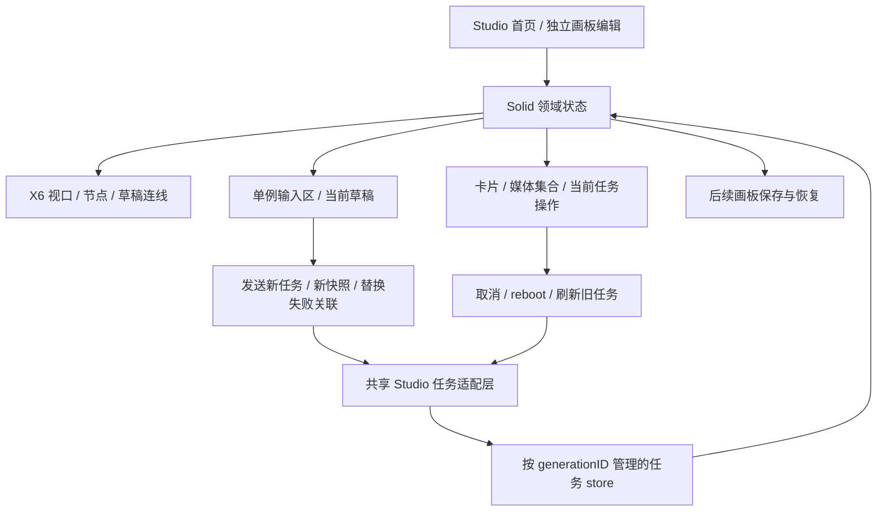

# Studio 画板模式功能与实现方案

更新日期：2026-11-17

文档状态：已按本方案编码画板编辑、同卡多任务、生成/取消/reboot、直接提示词策略、对话/画布会话分类与保存恢复；保留独立图片模拟模式。已完成包级类型检查、领域和接口测试及独立画板浏览器验证；完整 Electron 页面、真实模型服务及设备手感仍需联调验收，不表示已上线。

本版以最新讨论为准，替换初版“一卡一任务”“再次生成必须新建卡片”“取消后直接恢复空草稿”的生命周期方案。新的基本单位是：**一张固定媒体类型的卡片，可以汇集多个任务的结果，并在原卡片中继续提交新任务。**

本次已根据用户后续编码授权修改前后端、数据库迁移与 SDK；未重启应用或现有服务。下文产品规则继续作为验收依据，第 2.3、13.1 节记录当前实现和验证边界。

## 1. 目标与实现边界

在 Studio 中增加独立画板编辑模式，用户自由摆放图片或视频卡片，通过连线把上游图片卡片的当前封面用作下游生成参考图。卡片下方的单例输入区编辑当前草稿，任务创建、取消、reboot、结果查询和媒体处理复用 Studio 现有能力。

选型沿用 **AntV X6 + SolidJS**：X6 管理视口、节点、端口和连线；Solid 管理业务状态、卡片、结果列表和输入浮层。

分为两层交付：

- **图片模拟模式**：设置 `VITE_STUDIO_BOARD_DEMO=true` 后，新建画布使用内存状态和本地 SVG 模拟生成；支持参数编辑、多次生成、取消与重试，不调用画板/生成接口、不入库，退出或刷新后清空。已有正式画布不因该开关转为模拟模式。
- **正式模式（默认）**：已接入图片/视频生成、旧任务 reboot、取消、新任务提交、画板保存恢复及分类侧栏；创建第一张卡片时自动创建画布会话并保存，空提示词、尚无任务也会入库；手动保存、提交和上传参考图共用同一会话绑定流程。真实生成复用现有服务，需后端包含本次迁移与代码。

正式 Studio session 区分**对话 / 画布**两种固定类型，继续共享 agent="octo_studio"；画布类型 session 对应一张画板，画板内组织多张卡片及各卡片的多个任务。侧栏保留置顶、分组，将“最近”拆分为可独立展开收起的“对话”和“画布”，详见第 3.7 节。当前内存 demo 不创建真实 session，也不产生侧栏历史条目。

目标界面统一采用**固定浅色主题**，暂不支持深浅主题切换或跟随系统主题；画板撤销、重做暂不纳入实现范围。

图片输入区底部已接入**风格模型、图片设置、引用参考**三项；视频卡片将图片设置替换为视频设置，不追加其他参数入口，见第 3.4 节。

画板生成已确定采用**提示词直接提交**：不经过 LLM 自动扩写，不隐式继承对话或会话最近成功任务的提示词。该规则适用于画板图片生成及后续视频生成；原 Studio 对话模式保持现有逻辑。产品规则见第 3.6 节，真实接入注意事项见第 9.6 节，模拟模式不调用真实提示词处理链路；正式模式在服务端显式跳过扩写与历史提示词拼接。

画布交互同时补齐四项：**无箭头曲线与 hover 起点到终点的渐变流动、空白处右键创建、拖线落空后创建并自动连接、卡片左右外置圆形加号连接点**。沿用当前 X6 3.1.8 + SolidJS，无需更换绘图库或新增后端接口；图片 demo 先只提供图片创建选项，视频选项随视频卡片阶段接入，详见第 3.5、4.4～4.6 节。

“多个任务结果汇集到卡片”是任务与媒体的组织关系，不表示调用 `image.fusion` 能力，也不表示把多张图片拼接或合成为一张图片。当前范围描述卡片中多次生成所产生的任务与结果，不包含从 Studio 历史会话中选择已有任务加入卡片的功能。

## 2. 已确认规则与默认方案

### 2.1 核心产品规则

| 项目             | 规则                                                                                 |
| ---------------- | ------------------------------------------------------------------------------------ |
| 会话类型         | Studio session 固定为对话或画布；画布类型 session 对应一张画板，不按卡片创建 session   |
| 侧栏分类         | 保留置顶、分组；原“最近”拆为可独立折叠的“对话 / 画布”，按持久化类型分类             |
| 卡片身份         | 卡片 ID 稳定，不与某个唯一任务永久绑定                                               |
| 卡片与任务       | 一张卡片可以关联多个任务及其媒体结果                                                 |
| 媒体类型         | 卡片类型固定；图片卡片只包含图片，视频卡片只包含视频                                 |
| 卡片展示         | 主体一次预览一项结果或当前任务的进度/失败占位；可从卡片结果集合选择封面              |
| 生成中           | 右上角显示当前任务的进度数字和“取消生成”文字按钮                                     |
| 失败与取消       | 生成失败和手动取消均保留失败项，展示“生成失败”及具体原因；取消原因使用“用户取消生成” |
| 右上角“重新生成” | 指向当前失败的旧任务，调用该任务的 reboot，使用旧任务保存的输入                      |
| 输入区“发送”     | 使用当前草稿创建新任务；若当前有失败项，将本次失败任务从卡片可见关联中移除           |
| 提示词处理       | 当前卡片输入直接提交生成，不进行 LLM 自动扩写，不隐式继承对话或其他任务的提示词      |
| 卡片复用         | reboot 和输入区发送都留在原卡片，不自动新建卡片                                      |
| 失败项移除       | 后续在该卡片中不再展示被移除的失败任务；不等于删除服务端任务或会话历史               |
| 输入区           | 点击/选中卡片后在下方显示，支持 hover 展示的交互适配；全画板最多显示一个             |
| 连线             | 一条连线只引用来源卡片的当前有效图片封面，不展开全部任务结果                         |
| 连线表现         | 无箭头连续曲线；hover 时渐变高亮沿曲线从来源流向目标，不改变引用方向                 |
| 快捷创建         | 空白处右键与拖线落空共用创建菜单；图片 demo 只有“新建图片卡片”，不自动发起生成       |
| 连接点           | 左右外置圆形加号，左输入、右输出；视频卡片仍无右侧输出点                             |
| 提交快照         | 每次新任务提交固定实际使用的参数和参考图；之后上游变化不修改该任务                   |
| 视频输出         | 视频卡片可以接收图片输入，始终没有输出端口，poster 不能作为图片输出                  |

**reboot 入口必须受真实接口能力约束。** “失败时右上角有重新生成”适用于支持 reboot 的任务；创建失败、无上游任务 ID 或不支持的 provider 不能伪装成可重启任务。具体条件见第 5.4 节。

### 2.2 本方案采用的默认实现规则

以下是为落实上述需求采用的默认方案，后续产品调整时应同步修改关联章节：

- 每张卡片同时最多有一个活动任务；正式接入首期继续遵守现有会话的活动生成限制。
- 新任务的成功媒体加入原卡片集合，已有成功媒体继续保留。发送时只移除当前失败项，不清空历史成功结果。
- 卡片草稿与每个任务的提交快照分开保存；修改输入区不会反向修改旧任务。
- 失败时主预览展示本次失败占位，历史成功结果仍可查看，已有有效封面不被失败占位覆盖。
- 普通发送复用当前输入连线，不自动把本卡片的封面作为自己的参考图；“以此图继续创作”可显式新建另一张卡片和连线。
- 同一卡片多次生成可以积累多个任务及其同类型成功媒体；不规划“已有任务导入”入口。
- 正式画板绑定画布类型 Studio session，首期一个画布 session 一张画板；侧栏点击该条目直接恢复全页画布，不要求通过右侧媒体工作区进入。对话类型 session 保持普通对话入口，本期不做两种类型的相互转换。

### 2.3 当前编码状态

以下按本次实现核对，编码完成与联调验收分开记录：

| 功能 | 当前实现 | 验证边界 |
| ---- | -------- | -------- |
| 入口 | 首页对话/画布 tab；新建后覆盖 studio-page，左上角退出；正式会话按类型恢复 | 独立画板已浏览器验证；完整 Electron 路由需联调 |
| 会话与侧栏 | studio_mode 固定分型，旧值兼容对话；保留置顶/分组，新增独立折叠及分页的对话/画布分类 | 后端类型过滤与会话创建测试通过；共享侧栏完整操作需桌面回归 |
| 空画布 | 初始无卡片；图片创建，正式模式按权限开放视频创建 | 模拟模式只显示图片，不提供已有任务导入 |
| 图交互 | 点阵、拖动、平移、缩放、适应全部、Shift 框选、多选、对齐线 | 不实现撤销重做；真机手感仍需验证 |
| 输入区 | 单选卡片下方唯一浮层；草稿独立保存，活动任务锁定该卡输入 | 浏览器已验证输入和任务快照分离 |
| 参数 | 复用风格模型、图片/视频设置；引用参考支持显式连线、上传及插入提示词标记 | 图片保持三个底部入口 |
| 卡片与结果 | 同类型多任务集合；独立预览/封面；新发送仍在原卡片 | 异常媒体类型排除并提示 |
| 取消与 reboot | 进度、取消、失败原因、受能力约束的旧任务 reboot；新发送隐藏当前失败关联 | 浏览器验证取消/重试/新发送；本地上游集成测试验证同任务 reboot 幂等 |
| 连线 | 无箭头曲线、hover 流动渐变、外置加号端口、空白右键、拖线落空创建并连接 | 浏览器已验证快捷创建与引用；不自动生成或缩放 |
| 真实任务 | 图片与视频复用 Studio 任务服务；直接使用当前提示词与显式引用 | 临时 HTTP 上游测试通过；未调用真实付费模型 |
| 保存恢复 | SQLite 画板文档、revision 冲突检测、提交与重启操作标识、本地草稿备份/合并恢复 | 领域与两套路由测试通过；多窗口及断网场景需完整 UI 回归 |
| 主题 | 固定浅色，加载占位与图元素同步 | 已浏览器检查；无主题切换 |
| 滚轮 | 按 delta 距离换算，合并每帧事件并限制每帧增量，缩放范围 35%～180% | 距离/单位/边界单测通过，Magic Mouse 和触控板需真机确认 |
| 分享与导入 | 画布完整分享/导出/导入受限；不将导入媒体当作可控制的生成任务 | 普通对话传输逻辑保留，完整回归待验收 |


## 3. 入口、卡片与输入区

### 3.1 首页入口与独立画布

沿用当前 demo 的入口，不再按初版方案把画板放入右侧 StudioCanvasView：

```text
Studio 空对话首页
  StudioIntro
  对话 / 画布 tab（默认对话）
    对话：现有 StudioComposer
    画布：新建画布入口
      点击后：独立空画布覆盖 studio-page
        左上角：退出画布
```

- tab 切换本身不创建画布、会话或生成任务。
- 覆盖 studio-page 内的历史栏、中央对话区、右侧工作区和原输入区；不使用浏览器全屏，也不覆盖应用外壳。
- 保留普通对话的输入草稿，避免切换 tab 或进入画布导致内容丢失。
- 当前 demo 退出后销毁画布，返回首页并保持“画布”tab 选中；再次新建从空白开始。
- demo 退出或刷新后不保留内容，入口和画布应明确展示提示。
- 正式持久化阶段退出编辑器不删除已保存画板；未保存、活动任务和重新进入的处理见第 10 节。
- 切换实际服务、Studio 会话目录或用户主动切换会话时，按保存规则关闭/切换画布上下文，不能把临时状态写入另一个上下文；当前临时画板首次绑定新 session 属于状态迁移，不应因此卸载画布，见第 9.7 节。

### 3.2 卡片结构与任务状态展示

每张卡片包括：

1. 标题栏：固定媒体类型、卡片名称；右上角显示当前任务的操作和状态。
2. 主预览：空白占位、当前生成进度、失败占位，或一份媒体。
3. 结果入口：显示卡片成功媒体总数，打开来自多个任务的结果集合。
4. 连接点：左侧输入；具有有效图片封面的图片卡片右侧输出；视频卡片无输出点。
5. 选中边框与下方输入浮层。

右上角状态按**当前任务**计算，不按整张卡片所有任务合并计算：

| 当前操作 / 任务           | 右上角                             | 主预览与保留内容                                   |
| ------------------------- | ---------------------------------- | -------------------------------------------------- |
| 无当前任务                | 无进度或重试操作                   | 空白占位或历史媒体                                 |
| 提交中 / 创建中           | 对应阶段文字；有可靠进度时展示数字 | 展示创建占位；没有任务 ID 时不可假装取消已确认     |
| 排队中 / 生成中           | 进度数字 + 受能力约束的“取消生成”  | 当前生成占位，保留历史成功结果                     |
| 取消请求中                | “取消中…”并禁用重复操作            | 保留当前状态，等待服务端确认                       |
| 失败，包括手动取消        | 支持 reboot 时显示“重新生成”       | 主预览切到失败占位，显示错误原因，历史媒体仍可查看 |
| reboot 请求中             | “重新生成中…”                      | 防止重复 reboot 或发送                             |
| 状态异常 / 请求结果不确定 | “刷新状态”或“核对中”               | 不把未知状态当作失败或取消成功                     |
| 成功                      | 完成状态或收起活动操作             | 新媒体加入集合，已有媒体保留                       |

- 生成中进度数字可复用 Studio 的 0～100 校验；无实际进度的阶段不编造百分比。
- 取消按钮在卡片未选中时仍可操作，作用于这张卡片的当前任务，不依赖全局选中结果。
- 操作按钮使用不会冒泡触发 X6 拖动的事件绑定；当前 demo 已对卡片移除按钮使用直接 DOM 事件，其他节点内操作应遵循同样原则。
- 主预览的失败占位与封面身份分开：错误提示不会变成封面，也不会导致下游引用变成错误图标。

### 3.3 同类型结果集合与封面

- 一张卡片可以包含任务 A 的多份结果、任务 B 的多份结果及后续任务结果。
- 任务能力和生成结果必须与卡片类型一致；图片卡片不能通过切换模型或接收异常返回的视频变成混合卡片。
- 异常接口返回了其他类型媒体时，明确提示类型不匹配，不纳入卡片集合，不静默宣称全部结果已正常接收；保留原任务结果用于诊断。
- 结果集合按卡片内任务关联顺序、任务内服务端结果顺序稳定排列；不得使用到达时间或 URL 排序。
- 每项媒体保留来源 generationID 和稳定媒体 ID；缺少媒体 ID 时使用任务内持久化序号。
- “预览”和“设为封面”是独立动作。封面可以来自卡片关联的任意成功任务，不局限于当前任务。
- 新任务成功后可默认预览该任务的第一份有效媒体；已有用户封面保持不变，无有效封面时才初始化默认封面。
- 更换封面同步所有下游草稿引用，但不修改已提交任务的参考快照。
- 同一份媒体在一张卡片中按来源任务和结果标识去重；不以可变 URL 判断同一性。
- 视频结果集合只包含视频；poster 是视频的预览资源，不作为独立图片结果。
- 封面资源失效时明确提示，阻止依赖无效封面的新提交；不能悄悄换图继续执行。
- 首期不做结果裁剪、自由旋转、任意媒体删除或无来源的跨卡片封面替换。

### 3.4 单例输入区

当前需要实现的一版，输入区保留提示词编辑和发送，**底部参数设置仅有以下三项**：

| 参数入口 | 当前一版的范围                                                                                                     |
| -------- | ------------------------------------------------------------------------------------------------------------------ |
| 风格模型 | 复用 Studio 现有风格模型选择能力，按实际模型范围和权限展示；不等于“风格模板”                                       |
| 图片设置 | 在一个设置入口内组织现有图片比例、数量、尺寸等设置，沿用 Studio 的模型能力与校验，不拆成额外的底部参数入口         |
| 引用参考 | 复用 StudioComposer 的 `@` 图标，仅在 Seedream 图片风格模型下显示；将当前可用参考图插入提示词引用，不增加历史任务导入能力 |

- 初始默认值沿用 Seedream / 1:1 / 1 张，目标版通过上述入口编辑，不再把固定显示占位当成参数控件的完成状态。
- 已复用现有参数控件，模拟模式也记录草稿和提交快照；真实模式将同一快照传入任务服务。
- 模拟阶段将选择记录到当前卡片草稿和提交快照；真实生成阶段再接入对应服务参数，不能把模拟控件描述为已调用真实模型。
- 底部不追加风格模板、图文反推、素材库等其他工具项。提示词编辑、参考图展示和发送按钮不计为额外参数设置项。
- 视频模式、首尾帧、时长、画质等属于后续视频阶段；当前图片版不增加这些入口，不因此把图片卡片变成可切换媒体类型的卡片。

交互规则：

- 点击/明确选中卡片后显示其草稿；hover 不改变选中状态或展开输入区，鼠标离开卡片也不取消已有选中或关闭正在编辑的输入区。
- 输入框聚焦、输入法组合输入、菜单展开或鼠标位于浮层时保持显示；点击空白或切换卡片后再收起。
- 全画板最多一个输入浮层，多选时隐藏单卡输入区。
- 切换卡片恢复各自草稿；不会用当前任务保存的参数不断覆盖用户正在编辑的草稿。
- 三项设置均属于当前卡片草稿，切换卡片恢复对应选择；发送时形成新快照，右上角 reboot 仍使用旧任务参数。
- 切换图片模型时，合法的自定义尺寸继续保留；不符合新模型限制或缺少任一边时回到预设比例并清除自定义尺寸状态。前端发送和本地后端受理共用尺寸校验；读取或恢复旧草稿时仅修正草稿参数，不改写历史任务快照，也不因旧草稿尺寸不合法拒绝整张画板。
- 参数内容复用 StudioComposer 面板，以工具栏按钮为锚点独立浮动，保留原面板宽度、圆角和阴影；不参与输入区高度计算，超出画布时避让并滚动。点击外部或 Esc 收起。
- 发送始终创建新任务；右上角“重新生成”始终使用旧任务快照。两个入口不能共用一个含糊的提交分支。
- 生成、取消、reboot 或状态核对期间禁用本卡片发送；其他卡片仍可编辑草稿。
- 输入区始终以卡片底部中心为锚点，水平居中并保留下方 16px 间距；字号和合理宽度不随画布等比缩小。输入区本身不做上下、左右边界避让，超出画板可见范围的部分允许裁切，由用户平移画布查看，不自动移动视口。参数弹窗仍独立按画板边界避让。
- 平移、缩放、窗口变化及参考图行变化后重新定位，使用 requestAnimationFrame 合并更新。
- 菜单、输入框和媒体控件不触发拖拽、平移、删除；组合输入期间不触发发送快捷键。
- 点击空白仅收起浮层并保留草稿；demo 中“保留”仅指内存，正式保存见第 10 节。

### 3.5 空白处右键创建与共用菜单

- 在画布空白处右键显示创建菜单，图片 demo 仅有“新建图片卡片”；视频卡片实现后再增加“新建视频卡片”，当前不展示不可用的视频占位选项。
- 通过 X6 的 blank:contextmenu 监听空白右键，阻止该区域的浏览器默认菜单；卡片、输入框、媒体控件和工具栏不误触发空白菜单。
- 右键菜单与第 4.6 节拖线落空菜单复用同一组件和创建操作，区别只在是否携带来源卡片、端口及待连接上下文。创建选项由已实现卡片类型和连接兼容规则决定。
- 菜单使用屏幕/浮层容器坐标定位，并在画板边界内避让；创建位置单独通过 graph.clientToLocal() 转为画布坐标。菜单避让不能改变用户指定的落点，避免平移、缩放后创建位置偏移。
- 点击“新建图片卡片”在右键位置附近创建空草稿，选中新卡片并显示输入区；必要时按实际卡片及外置连接点范围避让已有卡片，不创建任务或自动生成图片。
- 快捷创建保持当前缩放比例和视口；不沿用当前 addCard() 对新增第二张及后续卡片自动 zoomToFit() 的行为。“适应全部卡片”仍由用户显式触发；输入区空间不足时按第 3.4 节保持卡片下方定位，由用户平移画布查看。
- Esc、点击菜单外部、开始平移/缩放或切换画布上下文时关闭菜单；有拖线预览时同步取消。支持键盘聚焦、选择与关闭，关闭后恢复合理焦点。
- 菜单操作不触发画布拖动、空白点击收起输入区或卡片删除；在空画布提示层覆盖区域也应能触发空白右键菜单。

### 3.6 提示词直接提交

画板以当前卡片草稿和显式引用作为生成依据，**用户输入的提示词直接提交到生成，不经过 LLM 自动扩写、润色或补全**。具体规则如下：

- 无参考图的纯文本生成与有参考图的生成采用同一直接提交策略；后续视频生成也遵守此规则。
- 不追加 Studio 对话上下文、会话最近成功任务的提示词、本卡片历史任务提示词或其他卡片描述；同一卡片连续发送也不隐式理解为“延续上一轮画面”。
- 连线提供上游当前封面图片引用，不自动附加上游任务的提示词。用户需要延续已有内容时，通过当前草稿和明确引用表达。
- 保留提示词输入校验、必要的格式规范化、引用标记解析和媒体参数映射；这些步骤不得改写语义或补充描述。不跳过模型、权限、参数及素材校验。
- 输入区发送使用当前草稿创建新任务；右上角“重新生成”使用旧任务实际提交的提示词、参考图和参数执行 reboot，不重新扩写，也不读取新草稿。
- 本版不增加自动扩写开关或提示词优化入口，底部仍只有风格模型、图片设置、引用参考三项；界面不增加“提示词扩写中”阶段。
- 直接提交是画板的生成策略，不改变原 Studio 对话模式的自动扩写、推荐或其他提示词处理行为。

### 3.7 侧栏“对话 / 画布”分类

沿用现有侧栏的折叠标题和列表行，保留置顶、分组，将原“最近”拆为两个同级分类：

```text
我的资产
▾ 置顶
    已置顶的对话或画布
▾ 分组
    ▸ 项目 A
    ▸ 项目 B
▾ 对话
    未置顶、未归组的对话 session
▾ 画布
    未置顶、未归组的画布 session
```

- 对话/画布是 session 类型；置顶/分组是组织方式。两类均可置顶、加入同一分组，使用不同类型图标区分；不额外保留重复展示同一批条目的“最近”区域。
- 延续现有去重规则：已置顶条目只在置顶区展示；已归组且未置顶的条目在分组中展示；其余按类型进入对话或画布区。取消置顶或移出分组后，按剩余组织关系和原类型返回对应位置。
- 对话、画布区域各自默认展开，分别保存 UI 折叠偏好；两者不是互斥手风琴。偏好按服务、实际 Studio 会话目录和分类隔离，不写入生成任务参数。
- 新建或主动打开条目时展开其所在分类、分组或置顶区，并定位当前项；后台进度更新不强行展开。折叠只隐藏列表，不取消任务、卸载当前编辑器或清空草稿。
- 点击对话条目打开普通 Studio 对话；点击画布条目直接恢复该 session 的全页画板。侧栏提供进入和恢复入口，画布打开后仍覆盖整个 studio-page，不改为常驻侧栏的局部画布。
- 重命名、置顶、分组移动和排序不改变类型；不允许通过跨“对话 / 画布”区域拖放转换类型。同类型列表内排序可复用现有规则，混合类型的置顶及分组仍按已有组织规则排序。
- 首页 tab 仅选择新建入口，不转换当前已有 session。分组中新建时保留待归组意图，实际创建对话或画布 session 后再绑定到该分组；选择 tab 或进入临时空画布不提前消费该意图。
- 类型由服务端持久化信息决定，不依据标题、是否生成图片、是否有卡片或画板是否为空推断。已有未设置类型的本地历史 session 按对话兼容处理；明确为画布但恢复失败时显示错误/重试，不降级成对话或伪造空画板。
- 对话和画布分别展示空状态、加载状态、分页和重试；类型筛选必须在分页之前执行，不能只将混合结果的前 30 条在前端拆分后就断言某类没有内容。
- 当前不保存 demo 不进入这些历史列表；真实 session 类型接入和完整侧栏分类恢复分阶段实施，见第 12 节。

## 4. 连线、草稿与逐任务引用快照

### 4.1 连线作用于卡片的下一次新任务

多任务卡片不能继续采用“只允许连向从未提交过的卡片”的规则。输入连线描述卡片当前草稿，历史使用情况由每个任务自己的快照记录。

| 来源                                            | 目标                                              | 结果                                           |
| ----------------------------------------------- | ------------------------------------------------- | ---------------------------------------------- |
| 有有效图片封面的图片卡片                        | 可编辑的图片卡片草稿                              | 允许，供下一次发送使用                         |
| 有有效图片封面的图片卡片                        | 可编辑的视频卡片草稿                              | 按视频模式映射到参考图、首帧或尾帧             |
| 当前正在生成/失败，但仍有有效历史封面的图片卡片 | 可编辑草稿                                        | 仍可输出历史封面，不把当前进度或失败占位当图片 |
| 无有效图片封面的卡片                            | 任意草稿                                          | 禁止输出，提示等待或选择有效结果               |
| 视频卡片                                        | 任意卡片                                          | 禁止，没有输出端口                             |
| 任意卡片                                        | 自己或形成卡片级环                                | 禁止                                           |
| 任意卡片                                        | 正在提交、生成、取消、reboot 或核对状态的目标卡片 | 锁定本次目标输入关系；不修改已提交快照         |
| 任意草稿边变更                                  | 既有任务的历史关系                                | 不产生影响；历史关系只读                       |

- 卡片成功或失败后，其下一次新任务草稿可重新编辑连线；不能因为卡片关联过任务就永久锁定输入。
- 上游封面可以来自该卡片的任意关联成功任务，输出判断依据是媒体有效性和类型，不是卡片最新任务是否成功。
- 首期不提供连完自动执行下游、运行中结果自动调度或循环工作流。
- 连线、新结果到达和封面变更均不会自动发起生成。

### 4.2 草稿引用解析

- 一条连线提供一张图片，不展开来源卡片全部任务或全部结果。
- 按持久化 order 合并连线引用与手工上传素材；去重保留首次顺序。
- 图片数量上限使用模型能力配置，超限明确阻止提交，不静默截断。
- 视频的普通参考图、首帧和尾帧绑定不同 targetRole；同一首帧/尾帧槽位只能有一个来源。
- 已有素材或连线占用槽位时，提示移除或明确替换；不自动覆盖。
- 拒绝同一来源卡片到同一目标角色的重复边；同一图片用于不同视频角色仍受实际接口约束。
- 引用缩略图提供定位来源和移除草稿连接；移除草稿边不删除任何既有任务快照。
- 模型或视频模式变更后重新校验角色与数量；失效引用可见，不直接清空用户草稿。

### 4.3 每个任务独立冻结参考图

```text
图片卡片 A：
  任务 A1 的图片 a1、a2
  任务 A2 的图片 a3
  当前封面 a2

卡片 B 的草稿连接 A：
  B 发送任务 B1：快照固定为 A / A1 / a2
  A 封面改为 a3：B1 仍使用 a2，B 下一次草稿显示 a3
  B1 失败，点击右上角重新生成：reboot B1，仍使用 a2
  B1 失败，点击输入区发送：隐藏 B1 的失败项，创建 B2，快照使用 a3
```

因此草稿连线与历史引用是两个数据层，不能在提交后把唯一一条可编辑连线永久改成历史边。

- 任务详情可展示“本次实际使用的图片”，按所查看任务选择快照，不默认展示最新草稿引用。
- reboot 不重新解析当前连线；发送新任务才解析当前草稿。
- 来源卡片或草稿边移除后，既有任务仍保留参考快照，并显示来源已移除。
- 快照必须包含来源卡片 ID、来源 Studio 任务 ID、结果 ID/序号、目标角色、顺序和原始素材引用。
- 原图或已持久化副本是生成依据；缩略图、视频 poster、临时 blob URL 或易失效签名 URL 不能作为唯一长期素材身份。

### 4.4 无箭头曲线与 hover 渐变流动

当前 edgeStyle 使用 manhattan 路由、rounded 连接器和 classic 终点箭头；圆角只修饰折点，不能满足连续曲线要求。

- 移除 Manhattan 直角路由，采用 normal 路由与 smooth 连接器，按左右端口设置水平贝塞尔曲线。显式设置 sourceMarker: null、targetMarker: null，避免继承 X6 默认箭头。
- 正式边、拖动中的预览边及代码创建的边共用曲线配置，避免不同创建入口出现不同线型。
- 默认显示浅色背景上可辨识的细实线；hover 时保留底线，并叠加带渐隐尾迹的高亮段，从 source 沿曲线运动至 target，停留期间循环，移出后停止并恢复底线。这是沿路径流动，不只是整条线静态变成渐变色。
- 使用 edge:mouseenter / edge:mouseleave 控制 SVG 高亮路径和动画；路径进度可用 stroke-dasharray / stroke-dashoffset 实现，并配合渐隐遮罩等方式形成尾迹。不能仅按屏幕水平方向移动线性渐变，反向或弯曲连线也必须按来源到目标的路径方向流动。
- 增加透明宽命中区域，便于 hover 细线；视觉叠加层不拦截鼠标，不影响原有连线移除、端口吸附及卡片拖动。取消箭头仅改变视觉，source / target 的业务方向保持不变。
- 节点移动、视口变化和曲线更新后同步动画路径；边移除或画布卸载时释放动画、监听及 SVG 定义。仅 hover 的连线运行动画，减少动态效果偏好下改为静态高亮。
- 普通平滑曲线不承诺自动绕开其他卡片。对目标位于来源左侧、上下错位、距离过近等布局检查曲线回折和穿卡问题，必要时扩展控制点或自定义连接器，不回退为直角折线。

### 4.5 卡片左右外置圆形加号连接点

- 沿用 X6 原生 ports，通过 markup 绘制圆形底、描边与加号，通过端口布局偏移将整体移到卡片左右外侧，和卡片边框留出间隙。连接点在卡片主体高度中部对齐，具体尺寸和间距随浅色视觉规范校准。
- 左侧表示输入，右侧表示输出；连线真实端点锚定对应端口，卡片拖动、平移和缩放时位置一致。不要只在 HTML 上增加装饰加号而让真实端口仍留在边框。
- 整个圆形区域可命中，加号图案不单独拦截鼠标；视需要增加透明命中区域，并检查 SVG 层级和裁切，确保卡片外的端口仍可见、可拖动和吸附。
- 无有效图片封面的图片卡片右侧可显示禁用加号及原因提示；有有效封面时按第 4.1 节允许输出，不以最新任务成功与否判断。视频卡片不显示右侧加号，也不能通过程序化连线绕过限制。
- 左侧端口只接收符合类型和角色的引用；目标处于提交、生成、取消、reboot 或核对状态时显示锁定状态。输入、输出、可连接、禁用和拖动吸附有明确 hover 提示和视觉区分，不能只依赖两个相同加号传达语义。
- X6 连接许可与最终登记关系的入口都检查目标卡片的操作锁，不能仅根据生成结果状态判断；上传、创建和未确认操作同样禁止新增引用。输入端口随锁定状态更新可连接性和透明度，核对完成后恢复。
- 本期加号作为连接点使用；单击加号直接创建不属于已确认需求。若后续增加单击菜单，必须用移动阈值区分单击和拖线，避免拖线结束又触发一次创建菜单。

### 4.6 拖线落空后快捷创建并自动连接

```text
从有效图片输出加号拖线
  ├─ 松开在合法输入端口：按既有校验建立草稿连线
  ├─ 松开在画布空白处：保留临时曲线，终点显示共用创建菜单
  │    ├─ 选择新建图片卡片：创建草稿，连接来源输出与新卡片输入，选中新卡片
  │    └─ Esc / 点击外部 / 视口或上下文切换：关闭菜单并清理临时线
  └─ 松开在无效节点、控件或画布外：取消，不误弹空白创建菜单
```

- 拖动期间维护独立临时状态，至少记录来源卡片 ID、来源端口、落点和预览边标识；松开时区分有效连接、真正空白及无效区域。只有确实开始并移动的输出拖线才能打开菜单，普通鼠标抬起不触发创建。
- 当前 allowBlank: false 会回退/移除落空边，而现有 edge:connected 处理又要求目标卡片存在；不能只把 allowBlank 改为 true 就视为完成。实现时结合拖动结束/鼠标抬起事件接管落空流程，必要时允许空白预览并单独管理，避免库的回退清理先丢失来源和落点。
- 临时线不进入正式 BoardEdge、草稿引用解析或持久化，不产生错误的缺失目标引用；edge:connected 也不能把未完成的预览当成正式关系。菜单等待期间保持预览可见。
- 选择创建时重新校验来源存在、类型和封面有效性，按第 3.5 节坐标规则放置新卡片，并按第 4.1、4.2 节执行同一套连接校验。新卡片输入端口尽量靠近原落点，碰撞避让后更新曲线终点。
- 将创建卡片与建立正式边作为一次领域操作提交，只写入一份关系；失败时清理本次临时卡片/边并提示原因，不能留下孤立卡片、悬空边或重复引用。图同步与 edge:connected 回调之间需防止重复登记。
- 完成后关闭菜单、清理预览、选中新卡片并显示草稿输入区；自动连接只增加下一次发送的参考来源，不调用生成接口。未来新增视频选项时，还需明确目标输入角色并执行槽位校验。
- 取消、来源卡片移除、来源封面失效、切换会话/项目或卸载时清理待创建状态；菜单开启后来源变化不能绕过确认时校验。保持原有正式卡片、连线、草稿及历史任务快照不变。

## 5. 多任务卡片生命周期

### 5.1 卡片状态与任务状态分离

一张卡片可以同时“拥有成功媒体”并且“当前任务失败”。不要再用 BoardCard.status 和单个 image 表达全部事实。

至少区分：

- 卡片：稳定身份、固定类型、布局、草稿、封面和媒体集合。
- 任务关联：哪些 generationID 在这张卡片中可见、关联顺序和来源。
- 当前任务：决定右上角进度/取消/reboot 和主预览状态。
- 活动操作：正在创建、取消、reboot 或核对的操作及其标识。
- 任务快照：各任务自己的提示词、参数和参考图。
- 媒体：由关联成功任务提供，始终保留来源身份。

任务仍使用 Studio 的 creating / queued / running / succeeded / create_failed / failed / abnormal 等现有状态。submitting、cancelling、rebooting、reconciling 可以作为前端操作状态，不能当成后端已有枚举。

```text
卡片 C（ID、类型不变）
  草稿 → 发送 → 任务 T1 创建/排队/生成
                   ├─ 成功：结果加入 C，继续允许发送 T2
                   ├─ 失败：保留失败项和原因
                   ├─ 手动取消成功：保留失败项，原因“用户取消生成”
                   └─ 状态异常：核对，暂不允许创建下一任务

  T1 失败项保留时：
    右上角重新生成 → reboot T1 → 仍在 C
    输入区发送     → 隐藏 T1 失败项 → 新任务 T2 → 仍在 C
```

### 5.2 输入区发送：创建新任务

发送既适用于空卡片，也适用于已有成功结果或当前失败的卡片：

1. 校验当前草稿、类型、权限、参考图和提交互斥。校验不通过时不移除失败项。
2. 生成本次 submissionID 和输入快照，按第 3.6 节记录当前提示词及直接提交策略，记录要替换的失败 generationID。
3. 进入提交中，当前失败占位从卡片展示中移除，使用新的提交占位；历史成功媒体和封面保留。
4. 调用创建接口，接受后把新 generationID 加入原卡片，并将旧失败任务标记为不可见。
5. 新任务成功后加入媒体集合；失败则展示新任务的失败原因。

补充约束：

- 只移除“此次失败任务”，不清空所有关联任务、历史媒体或旧任务参考快照。
- 旧任务仍存在于服务端会话/历史中，卡片仅解除可见关联。
- 用关联隐藏记录或移除记录防止轮询、恢复或会话事件再次把旧失败项加回卡片。
- 正式保存阶段，待替换上下文与提交标识也要进入可恢复的操作记录；服务端确认新任务受理时，原子完成新任务关联和旧失败关联隐藏，避免刷新丢失替换意图。
- 新请求未生成正式任务 ID 时，显示提交错误或核对状态，不伪造一个后端失败任务。
- HTTP 超时、断网或取消请求本身不证明创建未受理。保留提交标识及旧失败关联的替换上下文，先核对再决定重发。
- 请求明确被拒绝时展示本次提交错误；不会自动把旧失败项重新插回卡片，内部仍保留必要追踪信息。
- 成功卡片后续发送同样在原卡片创建新任务；新建卡片只由显式新增、复制草稿或“以此图继续创作”触发。

### 5.3 右上角重新生成：reboot 原任务

- 始终针对右上角所表示的失败 generationID，不使用“最近一个任务”或全局选中结果隐式推断。
- 使用服务端该任务保存的原始请求及有效参数，不读取当前输入区草稿和当前连线。
- 点击“重新生成”先关闭参数弹窗，将弹窗内尚未提交的尺寸等写回当前草稿，再进入 reboot 操作锁；旧任务仍使用原始快照。参数写入入口同时校验目标卡片的锁，防止弹窗已关闭后的延迟回调在重启或核对期间继续修改草稿。
- 沿用旧任务实际提交给生成服务的提示词，不再次调用 LLM 扩写，也不重新拼接历史上下文。
- Studio generationID 保持不变；provider taskId 可能更新，进度从本次执行重新计算。
- 不新增卡片，不重复插入同一个任务关联，不追加重复媒体。
- reboot 请求中禁用重复 reboot、普通发送和取消；接受后按新执行状态开放取消。
- 请求失败保留原失败项和原因，额外提示本次 reboot 错误，用户编辑的草稿保持不变。
- reboot 请求结果不确定时核对任务状态，不能把再次点击当成新的可安全重启请求。
- 同一 operationID 的未决重启只查询上游，不再次调用 reboot；刷新接口也可核对该操作。确认上游任务处于排队、运行或成功后，原子更新本地任务和重启记录，并恢复进度或结果。重启前读取并持久化上游 execution_id / start 基线；若核对已发现新执行且再次失败，同步新失败原因、状态和终态时间，并完成本次操作，允许再次 reboot 或输入区新发送。查询失败、仍只读到旧失败状态或缺少可区分执行的信息时继续返回待核对，不能据此认定请求未受理。升级前没有执行基线的记录，仅在上游执行开始时间晚于旧失败完成时间时确认新执行。
- 画板读取返回服务端 `pendingReboots`（cardID、generationID、operationID），没有本地缓存的窗口也能恢复核对入口；未决操作所属卡片不能移除。若上游另发新 task_id 且响应遗失、旧任务查询又未提供关联信息，仍需保留待核对；完整自动恢复需要上游提供关联或幂等查询能力，不能从旧失败状态猜测受理结果。

明确示例：

| 失败任务保存的内容  | 当前草稿            | 用户操作         | 实际使用内容                             |
| ------------------- | ------------------- | ---------------- | ---------------------------------------- |
| 红色汽车 + 参考图 A | 蓝色汽车 + 参考图 B | 右上角“重新生成” | 原任务的红色汽车 + A                     |
| 红色汽车 + 参考图 A | 蓝色汽车 + 参考图 B | 输入区发送       | 新任务的蓝色汽车 + B；旧失败项从卡片隐藏 |

### 5.4 现有 reboot 能力及例外

根据 studio-service.ts 的 rebootGenerationImpl，当前必须同时满足：

- status 为 failed，而不是 create_failed。
- provider 为 internel。
- 存在 provider_task_id；前端返回结构中对应 taskId。
- 满足现有会话提交限制、权限和操作互斥。

| 失败情况                        | 现有后端记录 / 条件                         | 右上角重新生成              |
| ------------------------------- | ------------------------------------------- | --------------------------- |
| 已有上游任务的普通失败          | failed + internel + taskId                  | 可调用 reboot               |
| 已有上游任务的手动取消          | 通常 failed + rawStatus 4，且有 taskId      | 满足上述条件时可调用 reboot |
| 创建上游任务前取消              | 通常 create_failed + rawStatus 4，无 taskId | 不支持 reboot               |
| 创建失败                        | create_failed                               | 不支持 reboot               |
| 不支持的 provider 或缺少 taskId | 不满足重启条件                              | 不支持 reboot               |
| 状态异常、超时未确认            | abnormal 或结果未知                         | 先刷新/核对，不直接 reboot  |

前端取消显示和数据识别：

- 手动取消的失败原因显示“用户取消生成”，与 Studio 对话的失败语义一致。
- 后端用 failed / create_failed 加 rawStatus 4 表示取消，rawStatus 要兼容数字和字符串；不新增假定的 cancelled 服务状态。
- 右上角只对可重启任务开放“重新生成”；其他失败保留原因，并提示通过输入区发送新任务。
- 不能让“重新生成”暗中退化为创建新任务。若未来要求所有失败均支持该按钮，需要先扩展后端恢复契约。
- Seedream 是模型显示，不足以证明 provider 支持取消或 reboot，必须检查实际任务和服务能力。

### 5.5 取消、终态竞争与旧响应

- 取消作用于卡片当前活动 generationID；获得正式任务 ID 后调用现有 POST /studio/generations/:generationID/cancel。
- 用户点击后显示“取消中…”，收到服务端确认后再展示取消失败项；不能清空卡片并立即开放新提交。
- 创建响应未返回 ID 时，应记录取消意图并核对受理结果。仅 abort 浏览器请求不能证明服务端任务已取消。
- 服务端已有创建阶段取消、上游任务稍后创建后的补偿处理；画板仍需按最终返回的任务状态展示，不能仅按调用时阶段猜测。
- 若取消与完成竞争，以服务端最终状态为准：已成功则接收结果，不覆盖成“用户取消”。
- 取消失败或超时后恢复查询/核对，保留任务操作入口；状态未确认前不能重复发送新任务。
- 只有已确认的普通失败或取消终态进入失败恢复分支；abnormal 仍走刷新恢复。

每次本地执行使用独立 runToken / operationID。异步回写至少检查 cardID、generationID、submissionID 或本次操作标识；同一个 generationID 被 reboot 后，还要比较执行标识、更新时间等，拒绝上一次执行的旧进度或失败响应覆盖新执行。

### 5.6 移除与恢复

- 移除卡片不删除任务、会话历史、素材或文件。
- 活动任务、取消或核对未结束时，首期先确认任务结束再移除卡片，避免失去操作入口。
- 活动任务、失败任务和成功媒体的恢复按原画板关联处理，不从会话历史中额外加入任务。
- 草稿复制生成新卡片 ID，不共享可编辑草稿，不携带原卡片的任务、成功媒体或活动任务控制权。
- 删除来源卡片时移除可编辑草稿边并重新校验引用；既有任务快照保留。
- 画板暂不提供撤销、重做；任务创建、取消、reboot 和失败项替换按各自业务流程处理。
- 刷新或重新进入画板时，按已保存关联恢复并查询任务；不能为了恢复界面而重新创建或重启任务。

## 6. 代码现状与接入位置

### 6.1 当前画板实现文件

| 文件                                                               | 已有职责 / 改造方向                                                            |
| ------------------------------------------------------------------ | ------------------------------------------------------------------------------ |
| packages/app/package.json、bun.lock                                | 已加入 @antv/x6 3.1.8，不再列为待安装                                          |
| packages/app/octoapp/pages/studio-page.tsx                         | 已有 boardEntry、首页 tab、lazy 加载和全页画布；保留独立页面模式               |
| packages/app/octoapp/pages/studio/board/studio-board.tsx           | 管理 X6、卡片/输入浮层、曲线与创建菜单、多任务控制、保存及模拟模式 |
| packages/app/octoapp/pages/studio/board/studio-board-state.ts      | 基于共享领域类型解析媒体、引用、连接与任务能力，处理滚轮距离缩放  |
| packages/app/octoapp/pages/studio/board/studio-board-state.test.ts、studio-board-operations.test.ts、studio-board-submission.test.tsx | 24 个测试，覆盖领域规则、操作锁、提交、恢复及多窗口冲突 |
| packages/app/octoapp/pages/studio/board/studio-board.css           | 固定浅色、菜单与结果集合、外置端口、连线高亮及减少动态效果适配       |
| packages/app/octoapp/pages/studio/board/studio-board-entry.css     | 首页 tab 和新建入口样式                                                        |
| packages/app/public/studio/board-demo/                             | landscape.svg、still-life.svg、architecture.svg 本地演示素材，不是真实生成结果 |

共享领域模型位于 `packages/core/src/studio-board.ts`；`studio-board-api.ts` 负责请求和备份格式。草稿、任务关联及逐任务输入快照已分离，旧单 image 模型不再使用。

### 6.2 可复用的 Studio 能力

| 文件                                                                                      | 可复用内容 / 注意事项                                                                                                        |
| ----------------------------------------------------------------------------------------- | ---------------------------------------------------------------------------------------------------------------------------- |
| packages/app/octoapp/pages/studio-page.tsx                                                | runGeneration、create/get/cancel/reboot/refresh 请求、媒体处理；存在全局 pendingResult、token、controller 等副作用，需要提取 |
| packages/app/octoapp/pages/studio/sidebar.tsx                                             | StudioSidebar 已接入共享侧栏，按 octo_studio 查询会话；需支持对话/画布分类及按类型打开                                      |
| packages/app/octoapp/components/grouped-sidebar.tsx、agent-sidebar.tsx、session-list.tsx    | 折叠标题、分页、置顶、分组、菜单及拖拽；扩展为可配置分类区域，保持其他模块默认行为                                           |
| packages/app/octoapp/pages/studio/studio-composer.tsx                                     | 富文本、素材、模型与参数控件；目标输入区按需复用，不直接复制整套页面状态                                                     |
| packages/app/octoapp/pages/studio/studio-result-card.tsx                                  | 进度、失败原因及 rebootable / refreshable 条件；提取展示与能力判定，保持对话模式行为                                         |
| packages/app/octoapp/pages/studio/types.ts                                                | StudioGenerationResult、StudioImage、现有状态和能力                                                                          |
| packages/app/octoapp/pages/studio/turns.ts、studio-session-data.ts                        | 会话恢复、任务与媒体合并                                                                                                     |
| packages/app/octoapp/pages/studio/studio-media.ts、studio-media-thumbnail.tsx             | 原图、缩略图、artifact 地址、失效恢复                                                                                        |
| packages/app/octoapp/pages/studio/studio-video-player.tsx、studio-thumbnail-generation.ts | 视频预览和缩略图流程，需验证在 X6 和全页浮层中的适配                                                                         |
| packages/app/octoapp/utils/persist.ts                                                     | 后续草稿缓存和视口恢复，不用于当前内存 demo                                                                                  |
| packages/opencode/src/studio/studio-service.ts                                            | 创建、查询、取消、reboot、刷新和提交互斥                                                                                     |
| packages/opencode/src/studio/studio-generation.sql.ts                                     | 现有生成任务及请求结果存储                                                                                                   |
| packages/opencode/src/server/routes/instance/httpapi/groups/studio.ts                     | 现有接口 schema，后续画板关联契约的扩展位置                                                                                  |
| packages/opencode/src/server/routes/instance/httpapi/handlers/studio.ts                   | 对应服务处理入口                                                                                                             |

入口不再依赖给 StudioCanvasView 添加 board 值。该类型仍管理原有 canvas / file-manager / template-creator；画板覆盖整个 Studio 页面，是独立页面模式。

不能直接把现有 cancelStudioGeneration / rebootStudioGeneration 回调接到所有画板卡片：这些函数会修改当前结果、全局 generationToken 和轮询。共享请求层应返回结果，由画板按显式上下文更新对应任务。

### 6.3 主分支会话管理更新的影响

本次对比 merge dev（1f3e95dce）与其第一父提交：SessionTable、StudioGenerationTable 和 studio-service.ts 未发生修改。主要变化在统一侧栏、分组/置顶、会话新建复位、分享及导入；多任务卡片、取消、reboot 和直接提交提示词的目标无需重写。需要适配的现状如下：

- StudioPage 外层新增 namespace="studio" 的 MakeGroupsProvider；原 StudioHistory 替换为 StudioSidebar，共享分页、分组、置顶和菜单能力。画板不另建一套会话分组数据。
- Studio 使用 useProjectDir({ mode: "config" }) 解析实际 sessions 目录，合并前已如此；不能误写为本次将项目 session 迁移到新表或新目录。路由中的 dir slug 不应直接替代实际请求目录。
- createStudioSession 新增 assignSessionToPendingGroup；画板建会话时要承接同一归组流程。当前 boardEntry 随路由会话变化关闭，新增的 ?hint= 空白页也调用 resetStudioConversationState；正式绑定画板 session 需要区分自发迁移和用户新建/切换。
- createStudioSessionData 保留 session.get 直读结果，为侧栏/同步尚未加载时提供会话信息。画板不能因分页列表缺少该 session 就误判不存在并另建会话。
- 页面通过 setStudioSessionGenerating 上报生成忙碌状态，服务端分享增加 isStudioSessionGenerating 检查；画板独立任务状态需加入统一汇总，见第 9.8 节。
- 分享导入可从 tool parts 物化媒体到“我的资产”，但不创建对应 studio_generation 行；有媒体或残留 generationID 不等于有可控制的本地任务，见第 10.5 节。

这些现有能力不代表本方案的 studio_mode、侧栏对话/画布分类或画板保存接口已经实现。

## 7. 前端实现结构

在已有 board 目录内渐进拆分，不推倒重写图交互，也不为文件数量创建薄包装：

| 模块                                     | 状态            | 职责                                              |
| ---------------------------------------- | --------------- | ------------------------------------------------- |
| studio-board.tsx                         | 已有，逐步精简  | 页面容器、工具栏、空状态和单例浮层编排            |
| studio-board-state.ts                    | 已有，需重构    | 卡片、任务关联、媒体身份、草稿和领域操作          |
| studio-board-entry.css、studio-board.css | 已有            | 入口和画布样式                                    |
| studio-board-graph.ts                    | 按复杂度新增    | X6 节点、端口、连线、坐标和生命周期               |
| studio-board-card.tsx                    | 按复杂度新增    | 预览、任务操作、进度和失败原因                    |
| studio-board-composer.tsx                | 按复杂度新增    | 单例草稿编辑与新任务发送                          |
| studio-board-results.tsx                 | 新增            | 同类型多任务结果集合、预览和封面                  |
| studio-board-generation.ts               | 新增            | create / cancel / reboot / refresh 适配及回写隔离 |
| studio-board-references.ts               | 可由 state 提取 | 草稿解析、类型与数量校验、逐任务快照              |
| studio-board-persistence.ts              | 存储阶段新增    | 文档版本、保存、恢复、冲突和隐藏关联              |

### 7.1 数据来源与图交互



- Solid createStore 是业务来源，X6 只持有卡片标识和必要图形信息。
- 任务 store 按 generationID 共享真实状态；卡片任务关联和媒体集合不能各复制一套权威状态。
- 拖动期间更新视觉，结束后提交布局操作；同步 X6 时避免事件循环。
- 活动任务变化不重建整个 Graph、卡片输入编辑器或其他卡片。
- 共用创建菜单和待连接状态放在临时交互 store，X6 预览边与正式草稿边分开管理；右键与拖线创建复用同一领域操作，不额外建立一套引用规则。
- 菜单、预览边、hover 动画及相应事件随当前画布清理；这些临时状态不写入画板文档，也不在恢复时重建。
- 本期不接入 X6 History，不维护图编辑撤销/重做栈。

### 7.2 HTML 节点与浮层生命周期

- 沿用 X6 HTML 节点挂载 Solid root，继承现有 Studio context；在移除和卸载时显式 dispose。
- 卡片内按钮使用直接事件监听或等价 guard，在 X6 收到拖动事件前阻止传播。
- 输入区、菜单和媒体预览放在画布 overlay / Portal，避免 foreignObject 裁切与等比缩放。
- 使用 X6 坐标转换后扣除 overlay 偏移，按帧合并定位。
- 清理 observer、动画帧、事件、模拟计时器、请求订阅、播放器和 HTML host 引用。
- 正式模式退出画板时停止视图订阅，不把“组件卸载”当成真实任务取消；任务应能从保存的关联中恢复。

### 7.3 共享侧栏的分类扩展

- 在 StudioSidebar 中声明对话/画布分类，向共享侧栏提供可配置区域及类型感知的打开行为；复用 SidebarSectionHeader、SessionList、菜单、重命名、置顶、分组和拖拽处理，不复制两个完整 GroupedSidebar。
- 共享组件为其他模块保留现有“最近”默认行为，Studio 的两个分类各自维护折叠、加载和分页状态。列表、置顶、分组和当前项直读按 sessionID 合并，不因分类维护多份相互独立的会话对象。
- 每类维护独立游标和请求标识，缓存键至少包含服务、实际目录、类型及查询条件；归组、置顶或排序后按受影响区域失效缓存。迟到响应不能写入新目录、新服务或另一类型列表。
- 当前会话未在已加载页中时使用 session.get 回填；读取失败区分未找到、无权限和网络错误，不能用分页缺席推断删除。
- 点击、深链和页面刷新统一先确认 session 类型再打开对应视图，不依赖临时 tab、URL 查询参数或仅存于内存的 boardEntry 推断。实际路由形式随接入确定，持久化类型为权威依据。

## 8. 目标数据模型

下表描述领域结构；已编码 schema 以 `packages/core/src/studio-board.ts` 为准，并复用现有 Studio 任务请求/结果类型。

### 8.1 画板文档

| 字段                     | 含义                                                              |
| ------------------------ | ----------------------------------------------------------------- |
| id / sessionID           | 画板及所属画布类型会话，一会话一画板；当前 demo 不创建真实会话     |
| schemaVersion / revision | 结构版本及保存修订号                                              |
| viewport                 | 平移和缩放                                                        |
| cards / draftEdges       | 卡片与下一次新任务使用的草稿边                                    |
| removedCards             | 卡片移除记录；任务隐藏状态保存在对应 taskLinks 中，防止恢复时复活 |
| updatedAt                | 文档更新时间                                                      |

服务地址、实际 Studio sessions 目录和会话共同构成隔离上下文。正式缓存和查询都必须携带该上下文；配置目录由现有 useProjectDir({ mode: "config" }) / octoSessionsDir 解析，不硬编码路径，也不使用当前 Git 项目目录替代。

### 8.2 卡片与关联任务

| 字段                    | 含义                                                                              |
| ----------------------- | --------------------------------------------------------------------------------- |
| id / kind               | 稳定卡片 ID，固定 image 或 video                                                  |
| title / position / size | 名称和布局                                                                        |
| taskLinks               | 有序的任务关联，含 generationID、来源、可见性和关联标识                           |
| mediaRefs               | 卡片中的有序媒体成员引用，不重复存储媒体本体                                      |
| coverRef                | 来源 generationID + mediaID/稳定序号                                              |
| previewTarget           | 当前预览媒体、任务进度或失败项，与 coverRef 独立                                  |
| currentGenerationID?    | 决定本卡片当前任务操作的任务 ID；不是唯一任务绑定                                 |
| draft                   | 当前提示词、参数、上传素材、草稿版本                                              |
| activeOperation?        | 操作类型、submissionID / operationID、runToken、目标 generationID、待替换失败关联 |

- taskLinks 决定卡片包含哪些任务，任务 store 决定任务真实状态和结果。
- 每个任务关联包含稳定关联 ID、generationID、order、对应提交标识和可见性；隐藏时保留原因及 replacedBySubmissionID 等追踪信息。若存储层另建关联表，文档内只保留引用，不能维护两份相互独立的隐藏状态。
- mediaRefs 表达成员选择与顺序，实际媒体属性从对应成功任务读取；缓存不能成为另一份结果来源。
- 同卡任务关联、同卡媒体身份唯一；任务结果合并及画板恢复过程显式处理重复与类型冲突。
- 成功媒体必须有来源身份；任务失败或取消占位不是媒体成员。
- 当前任务结束后仍可保留 currentGenerationID 用于失败操作或结果查看；是否忙碌由 activeOperation 和真实任务状态共同决定。
- 历史任务被隐藏后可在内部保留审计、请求关联和快照，不能继续作为卡片可见失败项或自动恢复的依据。

### 8.3 提交快照与执行尝试

草稿边字段建议为 id、sourceCardID、targetCardID、targetRole、order。X6 节点 ID 与卡片 ID 由图适配层映射，业务引用不依赖图引擎的临时节点遍历结果。

每次新任务创建保存：

- cardID、submissionID、草稿版本和创建意图。
- 用户输入的提示词、必要格式/引用转换后实际提交的提示词，以及直接提交策略；不把未经 LLM 处理的提示词标记为扩写成功。
- 当次模型、能力、尺寸、数量、视频参数及上传素材。
- 引用来源 cardID、generationID、mediaID/序号、原图素材引用、目标角色和稳定顺序。
- 所使用草稿边的标识和当次解析结果。
- 被替换的失败关联标识，便于原子保存和不确定请求恢复。

每次 create、cancel、reboot、refresh 请求携带本地执行标识；reboot 同一 generationID 的不同执行不能仅靠 generationID 区分。

现有 StudioGenerationResult.images 继续沿用，kind 区分媒体类型。媒体身份不依赖 URL、标题、数组临时遍历顺序或 X6 节点数据副本。

### 8.4 Studio session 类型与兼容

建议以 studio_mode: "conversation" | "board" 表达固定类型。该字段是待新增契约示例，最终存放在 SessionTable 的可选字段还是 Studio 会话扩展表，应在 schema 设计时统一确定，并通过会话读取、列表和事件返回，不维护两份类型来源。

- 两类仍使用 agent="octo_studio"，分组 namespace 仍为 studio；不按卡片建立 session，不为侧栏分类另造一套 agent。
- 创建会话时确定类型。board 类型对应一张画板和其中多张卡片；任务仍按 generationID 归属同一 session，消息/parts 是任务投影，不因此把画布会话显示成普通对话。
- 本地旧 session 缺少类型时兼容为 conversation；后端类型过滤必须包含这一兼容规则，不能只在客户端显示时补默认值。显式 board 类型即使尚无任务或文档为空，也仍是画布。
- 创建、读取、列表分页及更新事件使用同一类型含义；类型筛选先于 limit/cursor，分页排序及游标应与当前查询一致。
- 类型创建后固定，本期不提供对话/画布互转；重命名、排序、置顶、归组和退出画板不修改类型。普通会话更新接口不得意外重置类型。
- 分组映射、置顶、排序复用现有结构；画板文档与 board session 的关联和删除约束需保证唯一性与一致性。修改共享 schema 时检查其他 agent 及旧数据兼容，并重建 SDK。

## 9. 真实任务接入

### 9.1 共享适配层与新任务提交

1. 按第 9.7 节取得并核验所属画布 session，明确传入 sessionID、cardID、上下文、草稿版本、submissionID 和本次快照。
2. 校验固定卡片类型、模型能力、权限、会话互斥、参考角色和数量。
3. 在一致读取中解析输入；媒体异步持久化期间上游封面变化不改变快照。
4. 持久化生成所需原图和上传素材，按第 9.6 节构建直接提交的独立请求，不回退读取页面全局输入或对话上下文。
5. 为新提交记录 pending 替换上下文，按第 5.2 节处理当前失败项。
6. 调用现有创建能力；未来服务端原子记录画板关联及幂等标识，返回 generationID。
7. 按 cardID + submissionID 更新任务关联与 currentGenerationID，不新增卡片。
8. 按任务 ID 合并查询和会话事件；成功媒体稳定加入原卡片，失败只影响本次任务展示。

不能让会话最近成功任务、卡片当前封面或其他卡片素材隐式成为生成参考。

### 9.2 取消适配

- 显式传入目标 cardID、generationID 和当前执行标识。
- 请求受理、取消中、取消已确认、取消失败和未知状态分别处理。
- 创建 ID 尚未返回时记录取消意图；取得 ID 后继续取消或查询，不直接丢弃关联。
- 返回成功结果时以真实终态为准；调用取消接口并不保证最终一定是取消状态。
- 取消请求失败不删除任务、不清空历史媒体，不允许页面失去刷新和操作入口。
- 相同已取消任务的重复取消沿用现有后端语义；新增画板幂等不能只依赖按钮禁用。

### 9.3 reboot 与刷新适配

- reboot 仅对第 5.4 节允许的任务执行，参数由服务端旧任务决定。
- 增加新的本地执行标识，隔离旧轮询；服务端返回的新 provider taskId 更新到原任务，不新增 taskLink。
- reboot 后必须清理上一执行的取消/终止标记，重新订阅本次进度。
- abnormal 任务使用现有 refresh；状态确认后再决定展示取消、reboot 或新任务发送。
- 临时查询失败不是任务失败；不能把网络错误填进任务失败原因并开放重启。

### 9.4 并发、乱序与幂等

- 每张卡片一个活动任务；正式接入继续遵守当前会话限制，不额外开放同会话多任务并发。
- 切换卡片不停止后台任务合并，也不改变请求回写目标。
- 同时检查任务身份和执行身份，结合服务端 updatedAt / taskId 等拒绝陈旧结果；reboot 后不能采用“终态永远优先”而让上次失败压住本次运行。
- 已隐藏任务可以更新任务 store，但不能重新插回卡片可见关联。
- create/reboot 请求超时都需要核对；不能假设 abort 请求等于服务端未执行。
- 已新增持久化 submissionID、reboot operationID 及关联查询；不能把进程内互斥当作跨刷新幂等。上游重启响应丢失且服务端无法确认时保留 pending，不自动重复调用提供方。
- 若现有事件字段不足以区分执行，需要补充执行版本/操作关联，不能只靠前端随机 token 处理所有跨窗口或恢复场景。

### 9.5 原图、缩略图与权限

卡片展示缩略图，生成使用原图；复用现有 artifact 地址、原始媒体解析、缩略图生成和失效恢复。

本地上传先持久化再存引用，不把大体积 base64 塞进画板文档。临时 blob URL 只用于当前预览，移除和卸载时释放。

生成、reboot 和恢复均检查目录、会话归属及当前权限。显示有 Seedream 占位不代表权限已加载或真实 provider 支持相应操作。

### 9.6 直接提交策略与现有扩写链路隔离

当前 Studio 的任务创建链路不能原样用于画板。核对 studio-service.ts 与 studio-page.tsx 后，现状是：

- refineStudioPrompt 对无参考图的 image.generate / video.generate 默认进行 LLM 扩写，并读取当前会话最近成功任务作为上下文；带参考图的图片生成、带参考图或首尾帧的视频生成走提示词直传。
- extra.skipPromptRefine 为 true 仅关闭 LLM 调用，随后仍进入 promptRefineFallback；未提供已保存有效提示词等情况下，该分支仍可能通过 buildEffectivePromptFromPrevious 拼接上一成功任务的提示词。因此，仅由前端增加此标志不能满足画板的直接提交要求。
- 现有页面 runGeneration 还会构建 studioContext。画板不能原样复用包含对话语境和全局输入回退的提交逻辑。

正式接入时应落实以下约束：

1. 在共享创建请求与服务端处理中明确区分画板直接提交策略和现有对话策略；具体字段名称随 API schema 设计确定，不能只依赖前端约定。画板上下文及策略字段不作为模型参数透传给 provider。
2. 服务端直接提交分支在读取最近成功任务和调用 LLM 之前确定实际提示词，不经过会追加历史上下文的 fallback；已有 promptPassthroughRefine 可作为直传实现参考。
3. 画板请求不注入 studioContext，不恢复其他任务的 refinedPrompt / effectivePrompt。若为兼容现有请求存储保留这些字段，其有效值只来自本次直接提交结果，不能成为继承旧提示词的入口。
4. 按第 8.3 节保存原始输入、实际提交文本和处理策略；reboot 沿用旧任务请求，不重新执行提示词生成或草稿解析。输入区发送则按新草稿重新形成独立快照。
5. 仍复用任务创建、取消、查询、错误处理和 provider 参数校验。去掉 LLM 扩写不代表创建一定成功；创建前失败或取消的 reboot 限制继续按第 5.4 节处理。
6. 为原 Studio 对话保留现有默认行为，单独回归纯文本扩写、有参考图直传和历史上下文续接，避免修改共享分支导致对话模式行为变化。

正式模式已按上述要求增加 direct 策略；模拟模式不调用服务端。普通对话继续使用原提示词策略。

### 9.7 会话创建、归组与导航迁移

- 点击首页画布 tab 或只打开空画布不创建真实 session。创建第一张图片或视频卡片即自动创建 board session 并立即保存，允许提示词为空、没有任务关联。后续新增卡片也立即触发保存，已有保存冲突时保留草稿并等待显式重试。首次建卡保存、手动保存、任务提交和上传共用单一会话创建操作；生成在同一保存队列完成后提交，防止并发操作重复建会话。
- 使用实际 Studio sessions 目录和 agent="octo_studio"，在创建时写入 board 类型。创建成功后承接 assignSessionToPendingGroup 对应的待归组流程；只消费当前目录有效的意图，不因 tab 切换、进入空画布或失败重试错误归组。
- 已取得 sessionID 后遇到归组或保存失败，保留该 ID 并重试对应操作，不重新创建会话。请求结果不确定时先核对创建结果，再决定是否重发；会话创建的操作关联与恢复能力需要在真实接入时明确。
- 将临时画板 ID、草稿、卡片、连线和待提交快照迁移到新 session 上下文后，再更新路由和最近访问记录。使用明确的本次绑定标识，避免现有 boardEntry 路由监听或 ?hint= 复位将当前画布关闭、切回对话并丢失输入。
- 只对本次创建且匹配临时画板的迁移保留编辑器；用户主动打开其他 session、新建空白页、切换服务或实际目录时，按保存/退出规则切换。不能全局禁用路由清理，也不能让新建对话继续显示旧任务。
- 深链、刷新或侧栏打开既有 session 时，直读 session 类型并校验归属；不因同步列表尚未加载而新建会话。board 类型进入画板加载流程，conversation 类型进入对话，加载失败保留明确错误和重试。
- 新建分组意图随当前新建流程绑定，用户放弃并打开已有 session 时清理；归组后展开对应分组。分类和分组定位不得反过来改变 session 类型。

### 9.8 会话忙碌状态与分享门禁

- 现有页面的 setStudioSessionGenerating 主要依赖 pendingResult、sending 等对话状态。画板任务使用独立 store 后，应由共享会话级汇总入口计算忙碌状态，不由多个组件各自写 true/false，避免对话的空闲回写覆盖画板生成中状态。
- 汇总提交中、创建/排队/生成及取消/reboot 等尚未确认结束的活动操作；一个任务结束不能清除同会话其他活动操作。按实际服务、目录、session 隔离，切换页面或清理视图订阅不表示后台任务结束。
- UI 禁止分享的提示和按钮状态接入统一汇总；服务端继续以现有 isStudioSessionGenerating 及请求受理边界进行权威检查。涉及新操作阶段时核对服务端覆盖，不能只依赖前端禁用。
- 异常或状态未知按现有恢复规则核对，不伪造空闲或成功。忙碌汇总仅同步会话级状态，不把画板各卡片重新绑定到全局 pendingResult。

## 10. 持久化与服务端增量

### 10.1 当前与目标的区别

图片模拟模式完全不持久化；默认正式模式会创建会话、画板及任务记录，不能描述为“不入库 demo”。

正式接入后：

- 真实任务沿用现有任务/会话持久化。
- 画板存储卡片布局、多任务关联、媒体成员、封面、草稿边、隐藏失败关联、视口和草稿。
- 任务请求保存不可变输入快照；画板保存不能覆盖任务历史参数。
- 本地后端 SQLite 中的画板作为已保存文档，前端 localStorage 备份用于未保存草稿和失败恢复；当前两者都在本机。

### 10.2 已有接口

| 操作     | 现有接口                                       | 说明                                 |
| -------- | ---------------------------------------------- | ------------------------------------ |
| 创建任务 | POST /studio/generations                       | 会创建真实 Studio 任务和会话相关记录 |
| 查询任务 | GET /studio/generations/:generationID          | 获取真实状态与结果                   |
| 取消     | POST /studio/generations/:generationID/cancel  | 按现有 provider 与任务阶段执行       |
| reboot   | POST /studio/generations/:generationID/reboot  | 有条件重启原 Studio 任务             |
| 刷新异常 | POST /studio/generations/:generationID/refresh | 核对 abnormal 任务                   |

### 10.3 待新增的画板契约

| 操作            | 建议契约                              | 内容                                            |
| --------------- | ------------------------------------- | ----------------------------------------------- |
| 创建/读取会话类型 | 扩展现有 session 创建、读取与事件契约 | 固定 conversation / board 类型、归属与旧值兼容 |
| 分类列表查询    | 扩展现有 session 列表类型筛选        | 分页前按类型筛选，各分类独立游标及正确空状态    |
| 读取画板        | GET /studio/sessions/:sessionID/board | 文档、结构版本、revision 和任务关联             |
| 保存画板        | PUT /studio/sessions/:sessionID/board | 文档与预期 revision，冲突时拒绝陈旧覆盖         |
| 新任务关联      | 扩展创建任务的独立画板上下文          | cardID、submissionID、输入快照、待替换失败关联  |
| reboot 操作关联 | 按需扩展 reboot 上下文                | operationID、原任务及本次执行标识，避免重复执行 |
| 不确定请求恢复  | 按提交/操作标识查询关联               | 找回已受理的新任务或 reboot 执行                |
| 隐藏失败关联    | 纳入画板文档或关联服务                | 持久化隐藏状态，不删除原任务，不被事件重新加入  |

上述会话类型与分类扩展、画板 API、提交关联和执行级幂等已编码并完成相关自动化测试；完整页面联调状态见第 12 节。画板字段不透传给 provider 模型参数。

存储表字段遵循 snake_case，如 session_id、directory、schema_version、revision、document。保存时校验卡片类型、任务归属、媒体所属关联任务、封面合法性和引用关系。

修改 API schema 后按仓库要求运行 ./packages/sdk/js/script/build.ts，验证 SDK 生成产物。

### 10.4 保存、退出与恢复

- 新建卡片成功后立即排队保存整份画板；提示词、参数、布局、封面和草稿边等连续编辑按约 500ms 防抖保存。已保存版本写入本地后端的 SQLite，前端 localStorage 另存草稿与未确认操作用于恢复，两者当前均在本机。
- 正式画板尚无会话且没有卡片时只保留临时状态；创建第一张卡片后按第 9.7 节绑定 board session。恢复的临时卡片草稿也会自动保存，不必新增另一张卡片或生成任务。内部绑定导航保持编辑器；独立 demo 仍仅保存在内存。
- 保存与新任务提交共用串行队列，完整覆盖“保存当前画板 → 提交任务 → 回读关联和 revision”。提交响应延迟期间新增卡片的保存排在回读之后，避免本窗口使用旧 revision 触发冲突；已确认受理并完成同步的运行中任务不阻止其他卡片保存。保存中取消旧的防抖计时，期间的新编辑在请求完成后重新判断脏状态并安排保存。
- 提交结果或关联回读未确认时，暂停会改变 revision 的写入，保留脏文档和草稿备份；使用原 submissionID 核对，确认后自动继续保存。未决 reboot 同样保留核对入口。真正的保存失败或跨窗口 revision 冲突显示重试/重新加载入口并停止自动重试，不能因后续新增卡片悄悄清除冲突。
- 切换服务、实际 Studio 会话目录或用户主动切换会话前保留原上下文的待保存操作，异步响应不得写入新上下文。
- 使用 revision 乐观锁；冲突时保留本地变更并提示恢复或重新加载，不静默覆盖。
- 先读取画板成员和隐藏记录，再核对任务服务；不能从全部会话任务重新推导一份卡片列表覆盖用户组织关系。
- 已隐藏的失败任务和已移除卡片不得因为轮询、会话事件或恢复扫描而复活。
- 保存失败显示未保存与重试；恢复时区分前端未保存草稿和 SQLite 已保存版本。
- 加载及恢复选择完成前禁止提示词、参数、引用、卡片删除、布局和封面等文档编辑；仍允许查看结果、退出和核对/取消已有任务，退出保留原本地备份。完成恢复或保留服务端版本后再开放编辑。
- 首次读取失败时暂存原始备份及 pending/reboot 元数据，不在空文档上开放恢复，也不改写备份。连续重试失败仍保留原备份；只有读取已保存画板成功后才开放恢复/保留已保存版本的选择，并恢复仍有效的未确认操作标识。
- 重新加载服务端文档时，清理已移除卡片的提交/reboot 操作锁、缓存结果与轮询，令旧异步响应失效；按 submissionID 收敛已受理提交。仍存在卡片的未确认操作保留原操作标识，不能批量解锁。
- 正式退出编辑器保留已保存卡片和活动任务关联；重新进入后恢复控制入口，不因卸载自动取消任务。
- 退出与保存、提交共用队列，等待在途写入完成后再判断状态。存在待核对提交或 reboot 时不强制写 SQLite；确认当前草稿及原 submissionID/operationID 已写入前端备份后允许退出，重新进入后沿用原标识核对。备份写入失败时保留编辑器并提示，不能在尚未备份成功时退出。
- 从侧栏、分组、置顶或深链打开 board session 时直接加载已保存画板及其原有关联；退出返回非画布页面不转换类型。当前 demo 退出销毁内存的行为不套用到正式模式。
- 显式 board session 的文档读取失败时展示重试；确认文档缺失时明确提示并提供恢复处理，不能静默降级为对话、把既有任务重新铺成卡片或覆盖保存为空画板。
- 删除卡片不删除服务端任务；删除整个会话按现有会话清理流程同步处理画板文档、扩展类型信息和缓存，保留现有媒体快照语义。需覆盖侧栏及页面菜单等全部删除入口，不能只在画板退出时清理。

### 10.5 分享、导入和媒体身份边界

- 主分支现有分享/导出包主要保存会话消息、parts 和依赖资源，不包含 studio_generation 记录；此次导入会将 tool parts 中的媒体物化到“我的资产”，不等于恢复可操作的真实生成任务。
- 导入媒体的元数据可能保留来源 generationID，不能据此开放查询、取消或 reboot。任务操作必须核对本地真实任务存在、目录/会话归属和服务能力；媒体可见性与任务可控制性分开。
- 本期不实现画板布局、连线、草稿、隐藏关联及任务快照的完整分享/导出/导入；现有 Studio 对话分享继续沿用，画布 session 的分享/导出入口在完整契约支持前明确禁用并说明原因，不能生成丢失画板结构的分享或文件。
- 将来支持画板传输时，需要另行设计类型、画板文档和 ID 重映射，以及缺少本地原始任务的只读结果语义。在此之前不能将传输包里缺失的画布类型按“旧对话”默认值误判成完整恢复。
- 重新打开已导入的分享可能重新物化“我的资产”媒体，这不应恢复画板已隐藏的失败关联或已移除卡片。画板恢复只依据自身保存文档及关联记录。
- 上述兼容边界不新增“已有任务导入”或从历史媒体自动构建画板的能力。

## 11. 主题、输入设备与媒体性能

### 11.1 固定浅色主题

目标方案已确定统一使用浅色主题，暂不提供主题切换、跟随系统主题或深色配色适配。

当前画板代码、X6 图元素与加载占位已改为固定浅色；不提供主题切换。

- 画布使用浅灰或灰白底和淡灰点阵，卡片、输入区和工具栏使用浅色表面、深色文字与轻量边框/阴影。
- 同步调整选中边框、进度、错误/成功颜色、参考图标签、连线和连接点，保证浅色背景上的可辨识度。
- CSS 与 X6 背景、点阵、SVG 图形以及 lazy 加载占位一并改造，避免进入或加载画布时闪现深色区域。
- 沿用当前 Studio 的浅色视觉规范，不增加主题设置入口或主题偏好存储。

### 11.2 滚轮与苹果鼠标适配

已反馈：传统鼠标滚轮手感尚可，Mac 苹果鼠标滑动容易快速触及 35% / 180% 边界。

当前安装的 X6 滚轮逻辑默认 factor 1.2，按 deltaY 正负执行步进，包含按 5 个百分点取整及最小比例变化；虽按动画帧合并事件，但未按实际滚动距离缩放。底层横向滚动也可能触发回调，deltaY 为 0 会进入缩小分支。

后续改造建议：

- 由画板统一处理 wheel，避免默认监听与自定义监听同时执行。
- 按 deltaMode 统一像素/行/页单位，根据累计 deltaY 连续缩放。
- 忽略纯横向滚动，过滤极小抖动，限制每帧变化速度，并保留鼠标位置缩放中心。
- 统一处理惯性连续输入，不只按操作系统名称全局调低 factor，避免传统鼠标变得迟钝。
- 保留当前演示的缩放边界、100% 和适应全部卡片入口，具体灵敏度需在真实设备校准。
- 传统滚轮、Magic Mouse、触控板分别验收，不能以一次合成 wheel 测试替代真实手感验证。

### 11.3 视频与性能

- 视频卡片默认只加载 poster/缩略图，点击播放再挂载播放器，首期同时播放一个视频。
- 切换视频、离开视口或退出画板后暂停并释放必要资源。
- 多任务结果列表按需加载，非可见卡片不提前加载原始视频和全部原图。
- 更新当前任务进度只影响对应卡片；Graph 在挂载期保持稳定。
- 验证 Electron / 浏览器中 foreignObject、视频控件、文本选择、输入法和 Portal 层级。
- 快捷键的编辑保护覆盖 textarea、富文本、菜单和模态框；输入期间不触发卡片删除，不拦截编辑器自身的文本撤销/重做。
- 当前 demo 已有 Delete/Backspace、Esc 和 Ctrl/Command + Enter 等局部处理；空格拖动等需按实际实现验收，不把方案中的快捷键记为已上线。本期不注册画板撤销/重做快捷键。

## 12. 实施顺序与交付阶段

以下保留由原型到正式接入的阶段划分。本次已编码阶段一至四与阶段五中的多选/框选、对齐和浅色部分；设备手感、完整 Electron 场景和真实模型服务属于待联调验收。

### 阶段零：初始图片交互 demo（历史基线）

已编码：入口双 tab、新建空画布、全页覆盖和退出、图片卡片、单选浮层、固定参数、模拟进度和图片、基本连线与引用快照、实例清理。

此处记录最初原型状态；当前实现已替换其单任务和生成后新建卡片行为，现状见第 2.3 节。

### 阶段一：在图片 demo 中验证新生命周期

- 按第 3.5、4.4～4.6 节完成无箭头曲线与 hover 渐变流动、空白右键创建、拖线落空创建并自动连接、左右外置加号端口；图片 demo 仅显示“新建图片卡片”，不触发真实生成或保存。
- 共用创建菜单与领域创建操作，完成坐标转换、碰撞避让、取消清理和防重复登记；快捷创建不自动 zoomToFit，沿用既有手动适应入口。
- 重构卡片状态为任务关联、媒体集合、当前任务和独立草稿。
- 模拟多次发送在原卡片创建不同任务并累积成功图片。
- 增加右上角进度、取消生成、取消中、失败原因和受能力约束的重新生成。
- 模拟 reboot 同一任务及输入区发送新任务的不同路径。
- 增加运行标识，验证切换卡片、取消和重启后旧回调不串位。
- 改造草稿连线与逐任务快照；保留成功媒体的封面引用。
- 将底部固定参数占位改为“风格模型、图片设置、引用参考”三项，复用现有交互与校验；模拟阶段先维护卡片草稿和提交快照，不增加其他底部设置入口。
- 修正滚轮设备兼容，完善浮层编辑保持，以及三项设置菜单的定位和事件隔离。
- 将现有深色 demo 统一改为固定浅色主题，覆盖 CSS、X6 图形及加载占位，不增加主题切换。

交付标准：不调用真实生成或画板存储接口，就能完整验证四项画布交互和新版卡片生命周期；快捷创建与连接可取消且无残留，不再自动因发送而新建卡片。

### 阶段二：真实图片任务接入

提取共享 create/get/cancel/reboot/refresh 适配层，接入权限、输入持久化、错误展示、状态核对和任务级回写隔离。

新增 session 类型契约和旧数据兼容，在创建第一张卡片并首次保存时创建 board session，承接待归组意图并完成不卸载编辑器的路由迁移；接入 session.get 直读和统一忙碌状态，按第 10.5 节限制尚未支持的画布分享/导出。类型字段、列表筛选及 SDK 扩展在此阶段准备，完整分类恢复随阶段四交付。

按第 3.6、9.6 节接入画板提示词直接提交策略：前端不注入对话上下文，服务端不调用 LLM 扩写，也不通过 fallback 拼接历史提示词；保留原 Studio 对话模式的生成策略。

交付标准：首次绑定 session 不丢卡片、连线或待提交输入，不重复建会话；当前提示词直接生成，无隐式扩写或历史上下文继承；可正确取消、按原参数 reboot、以当前草稿发送新任务；已有成功媒体保留，失败项不会复活，不把不支持 reboot 的失败伪装成重启成功。

真实任务会沿用现有数据库写入，应与“不入库 demo”明确区分。阶段四前不承诺画板文档刷新恢复；界面应明确尚未保存的状态，已有 board session 不因缺少画板文档而伪装成普通对话。

### 阶段三：同类型视频卡片与完整媒体集合

接入视频输入角色、时长和画质能力、播放器、多结果列表及封面选择。结果集合来自同一卡片中生成的多个任务，图片卡片和视频卡片严格分型，视频没有输出端口。

在共用创建菜单中增加“新建视频卡片”；拖线创建视频时校验来源图片和目标角色，视频仍不提供右侧输出加号。

### 阶段四：画板保存与不确定请求恢复

增加画板存储、关联隐藏、revision、输入快照和创建/reboot 的操作幂等恢复；实现刷新、退出编辑器和切换会话后的恢复。

按第 3.7、7.3 节交付侧栏“对话 / 画布”独立折叠分类，保留共享置顶、分组、菜单和类型内排序；完成服务端类型过滤、独立分页、缓存隔离、当前项回填及旧 session 默认对话的兼容。

交付标准：画布条目从普通分类、置顶、分组或深链均直接恢复同一画板；归组和置顶不改变类型，缺失/加载失败不清空既有画板。临时画板首次建卡自动保存与首次生成共用会话绑定流程，所有删除入口同步清理画板关联，不影响其他模块侧栏。

### 阶段五：交互完善与联调验收

补齐框选、多选和对齐线；完成固定浅色主题、设备手感、媒体懒加载、Electron 事件冲突和原 Studio 功能回归。撤销、重做不在本期实施与验收范围。

## 13. 测试与验收

### 13.1 当前测试与后续覆盖

本次编码验证：

- `packages/app` 的 `bun typecheck` 通过；画板相关测试 56 项通过，加上共享 composer 回归共 64 项。覆盖失败/成功共存、引用与快照、独立图片/视频权限、滚轮、草稿合并、规范化保存比较及操作锁清理。真实组件测试覆盖弹窗未关闭时发送自定义尺寸、用户标识、400/409 与保存失败时恢复旧失败任务、网络未决时保持核对、视频首尾帧上传、恢复选择前保留备份、恢复/保留服务端版本、提交后多窗口冲突，以及无本地缓存时恢复服务端重启操作；HTTP 边界使用测试响应，图与组件使用实际实现。
- 首次建卡保存补充真实组件回归：图片/视频空卡片保存后可重开，空画布不建会话，新增立即保存与连续输入防抖，会话创建期间新增/发送共享队列，写入期间编辑不丢失，临时草稿恢复后自动入库，以及创建/保存失败保留备份并重试；独立 demo 不创建或保存会话。
- `packages/opencode` 与 `packages/core` 的 `bun typecheck` 通过；画板领域/本地上游集成测试 18 项通过，验证版本冲突、不可变类型与历史、上传参考图规范化比较、未决重启的会话级阻塞、引用归属、类型分页、直接提示词以及创建/reboot 幂等、用户标识、视频参数和自定义尺寸提交边界。连同既有取消与模型输入回归共 41 项通过。
- 本次 review 修复保留安全的 `extra.userIdx`，不继承旧对话上下文；上传参考图按共享 schema 规范化后比较。未确认的 reboot 阻止同会话的新任务及其他 reboot；明确拒绝新提交或保存失败时恢复旧失败项，网络未决继续保留核对入口。发送先关闭并提交参数弹窗，再建立不可变快照。视频使用独立生成权限及首尾帧上传入口，`@` 引用参考入口仍仅对 Seedream 图片卡片显示。
- 第二轮 review 已增加实际上游核对：503/网络未知不会被 HttpApi 当作明确拒绝，查询恢复排队/运行/成功时收敛操作记录，不重复 reboot；旧失败或查询错误仍保留未决。首次加载在完成备份比对和用户恢复选择前禁止写备份与自动保存。提交后仅在 revision 等于本次提交版本加一时接纳新版本号；超出预期时更新任务展示但保留旧版本号并停止自动保存，重新加载保留本地草稿供用户恢复，避免覆盖其他窗口修改。
- 第三轮 review 补充执行基线迁移与新失败终态恢复，覆盖旧失败不误判、缺少执行元数据不解锁、升级前记录按新执行时间核对及预查询失败不提交 reboot。恢复选择期间冻结文档编辑，恢复后可保存；重载清理已删除卡片的 reboot/生成/未确认提交锁与过期响应，同时保留仍存在卡片的核对入口。
- 本轮补充连续读取失败后重试恢复/放弃草稿及 reboot 标识保留、任务已受理但响应延迟时新增卡片保存、提交/回读未知后同标识核对再保存、X6 校验和最终连接入口的操作锁，以及切换模型和旧草稿的尺寸归一化回归；历史任务快照保持不变。
- 对齐线结束时显式清除 x/y 坐标，鼠标释放、指针取消和窗口失焦时也执行清理；组件回归覆盖正常结束与三种释放/中断事件，确认下一次拖动仍可显示对齐线，吸附坐标仍写入草稿。
- 后续交互修复补充 6 项组件回归：提交断网、关联回读失败和未决 reboot 的备份退出及重开核对，在途提交结束后退出，备份存储失败时保留编辑器，以及 reboot 前关闭并提交参数弹窗、锁定后拒绝延迟回调、核对后恢复参数编辑。
- 两套路由新增的画板测试通过；完整 `httpapi-bridge.test.ts` 为 21 通过、2 失败。失败涉及原有 workspace-upgrade 路由清单与 portable-share/portable-progress 参数 schema 差异，未将其当作画板通过项。
- 已按仓库脚本重建 JS SDK，并生成画板/session 字段、重启操作及执行基线的三份迁移；未手动迁移或重启用户正在运行的后端。
- 使用现有 Vite 服务的临时独立入口验证真实画板组件（图片模拟模式）：浅色界面、取消原因、旧快照 reboot、原卡片新任务及结果保留、拖线创建与自动引用。临时入口在验证结束后移除。
- 完整 Electron 入口/侧栏/路由、真实模型服务、跨窗口恢复与 Magic Mouse/触控板手感尚未完成 UI 联调。下方验收清单是后续完整验收标准，不因局部验证自动勾选。


后续测试应调用实际领域操作和适配层，尽量使用真实存储/现有测试设施，不在测试里重复实现被测算法：

- 旧 Studio session 缺少类型时作为对话，新建画布写入 board 类型；重命名、置顶、归组、排序和普通更新不会改写类型，类型与现有 agent/namespace 不混淆。
- 分类查询先过滤再分页；对话和画布各自维护游标、空状态及错误重试。覆盖首批混合数据中没有画布而后续仍有画布的情况，及过期页/事件跨服务或目录回写。
- 置顶、分组、对话、画布按约定互斥展示条目；取消置顶、移出分组、跨类型拖放和类型内排序正确，其他模块仍保留原侧栏行为。
- 首次建卡自动保存、连续新增卡片和首次发送竞争只创建一个 board session；归组/保存失败不重复创建，临时画板绑定导航不触发 boardEntry 或 ?hint= 复位丢失。用户主动新建/切换仍正常清理当前视图。
- 直接打开未在侧栏分页或同步 store 出现的 session 时，通过 session.get 取得类型和归属；网络错误不被判定为不存在，不另建重复 session。
- 分类/分组折叠偏好独立恢复；后台进度不强行展开，折叠不取消任务或清空草稿。打开条目能展开并定位实际所在区域。
- 会话级忙碌状态汇总画板活动任务，多个来源不会互相清除；前端分享门禁与后端校验一致，视图卸载不被当作任务结束。
- 导入 parts 物化的媒体即使带来源 generationID，也不会获得本地任务控制权；媒体重新物化不恢复画板隐藏关联。画布分享/导出未支持时入口明确受限，普通对话分享/导入保持兼容。
- 右键创建与拖线创建复用实际创建操作；缩放/平移后的落点转换、菜单边缘避让和碰撞避让正确，创建不自动缩放或发起生成。
- 拖线到有效端口不弹菜单，落空后预览保持且不进入正式引用；确认只生成一张卡片和一条边，Esc/外部点击、来源失效、视口/上下文变化及卸载后无残留。
- 无效落点、普通鼠标抬起、重复确认和连接校验失败不生成孤立卡片、悬空边或重复关系；拖线自动连接同样遵守封面、类型、角色、重复边和环校验。
- 同一卡片连续新建多个任务，成功媒体保留、顺序稳定、任务与媒体身份去重。
- 底部设置仅有风格模型、图片设置、引用参考；选择按卡片隔离并在切换后恢复，图片设置沿用模型限制和参数校验，引用参考不影响其他卡片草稿。
- 真实创建链路中，无参考图和有参考图的画板请求均直接使用当前输入，不调用提示词扩写 LLM；必要格式和引用转换不增加语义内容。
- 同一会话存在其他卡片的最近成功任务、同一卡片已有历史任务或已有对话上下文时，发送仍不拼接其提示词；覆盖 skipPromptRefine 关闭 LLM 后仍追加历史文本的回归风险。
- 图片/视频类型校验，包括异常混合媒体返回、同卡多任务结果合并和画板恢复。
- 当前任务失败但已有成功媒体时，失败预览、结果入口和封面均正确。
- 取消确认后显示“生成失败 / 用户取消生成”；取消失败、超时及取消与成功竞争按真实终态处理。
- 创建前取消得到 create_failed + rawStatus 4 时，不展示可执行的 reboot；有上游任务的取消按能力展示。
- reboot 使用旧快照和实际提交提示词，不重新扩写、不消费新草稿，不创建卡片或重复 taskLink。
- 输入区发送使用当前草稿和引用，创建新任务，只隐藏本次失败项。
- 输入校验不通过时失败项不消失；提交超时不会丢失受理核对线索。
- 已隐藏失败任务收到事件或刷新恢复后，不会重新出现在卡片中。
- 同 generationID 被 reboot 后，旧进度、取消响应或失败事件不能覆盖新执行。
- 两个上游卡片引用顺序、模型数量上限及视频角色冲突正确。
- 卡片封面跨多个任务切换，草稿跟随，历史任务及 reboot 仍用原快照。
- 有历史有效图片封面的卡片即使最新任务运行/失败，仍按封面合法性输出。
- 删除来源保留任务快照；移除草稿边不删除历史关系；界面恢复不创建或 reboot 任务。
- 创建、取消、reboot 与刷新防重复，状态未知时禁止盲目再次提交。
- revision 冲突、实际 Studio 会话目录/服务隔离、临时草稿迁移、隐藏关联和卡片移除恢复正确；所有会话删除入口清理画板文档、类型扩展和缓存，单独删卡片不删除任务。
- 从侧栏、分组、置顶及深链打开 board session 均恢复原画板；文档读取失败/缺失不会降级对话、重建任务或覆盖为空文档。
- 卸载清理 Graph、Solid root、事件、observer、计时器、订阅和播放器。
- 归一化 wheel 单位，纯横向及零纵向不缩放，连续小增量和离散输入不会产生每事件固定跳变。

### 13.2 人工验收清单

- [ ] 首页默认对话；切换画布 tab 不创建任务，点击新建才进入空画布。
- [ ] 侧栏保留置顶、分组，原“最近”拆为可独立折叠的对话、画布；默认展开、各自记忆状态，后台更新不强行展开。
- [ ] 历史未标记类型的 session 位于对话；画布类型按持久化信息分类。置顶/归组不重复展示，不因拖放、改名或 tab 切换改变类型。
- [ ] 两类独立加载、分页及重试；某类暂无已加载条目时不会误报没有内容，当前深链 session 不在侧栏第一页也能正确打开。
- [ ] 创建第一张卡片自动保存且只绑定一个 board session，不依赖生成任务；分组新建意图正确承接，路由迁移后当前卡片、连线、输入和画布视图保持。
- [ ] 点击对话打开普通对话；从画布分类、置顶、分组或深链打开画布均恢复原画板，加载错误提供重试，不变成空画板或对话。
- [ ] 画布、卡片、输入区、工具栏、X6 图形与加载占位统一为浅色，文字和连线清晰，无主题切换入口。
- [ ] 画布覆盖整个 studio-page，退出回到画布 tab，普通对话草稿不丢失。
- [ ] 当前 demo 明示不保存；正式模式的保存和退出行为与演示模式分开验收。
- [ ] 所有创建入口的连线均无箭头、无直角折点；hover 渐变高亮沿曲线从来源流向目标，移出停止，减少动态效果偏好下静态高亮。
- [ ] 空画布提示层及普通空白处右键均可打开菜单，图片 demo 只显示“新建图片卡片”；卡片、输入框和工具栏不误触发。
- [ ] 平移、缩放及靠近画板边缘时，菜单可见且卡片在指定位置附近创建；快捷创建不突然适应全部卡片或自动生成。
- [ ] 从有效输出拖到空白处松开后保留预览并显示同一菜单，确认后自动连接新卡片左侧并选中；连接已有合法端口时不弹菜单。
- [ ] 取消菜单、无效落点、来源移除/失效及退出后无预览残留、孤立卡片或重复引用；新增草稿关系不改变旧任务快照。
- [ ] 卡片左右为与边框有间隙的圆形加号，命中、吸附和曲线端点一致，移动缩放后不偏移或裁切；禁用状态清晰，视频无右侧加号。
- [ ] 输入区全局单例，编辑/菜单操作期间不会因 hover 离开而消失。
- [ ] 输入区底部只提供风格模型、图片设置、引用参考三项设置，交互可用且能恢复各卡片选择；提示词与发送正常，无其他工具入口。
- [ ] 画板提示词直接提交生成，无自动扩写开关或扩写等待阶段；纯文本及带参考图请求均不隐式继承对话、其他卡片或本卡历史任务的提示词。
- [ ] 单卡发送、reboot 和取消均作用于本卡当前任务，不依赖全局选中状态。
- [ ] 进度数字与“取消生成”在右上角；取消等待与失败原因展示准确。
- [ ] 支持 reboot 的失败显示“重新生成”，不支持的失败提示使用发送。
- [ ] 修改提示词后，右上角重启仍使用旧输入，输入区发送使用新输入。
- [ ] 发送移除本次失败项，原成功图片/视频仍在，卡片数量不因发送增加。
- [ ] 同卡多任务结果可查看和选择封面，卡片内媒体类型始终一致。
- [ ] 连线只引用当前封面原图，逐任务历史引用可查看，reboot 不跟随最新封面。
- [ ] 视频接收图片参考但没有输出点，poster 不被作为图片结果。
- [ ] 缩放后输入区仍可读，并保持卡片下方中心定位；靠近边缘时允许输入区裁切，用户平移画布后完整显示，参数弹窗独立避让；节点按钮不触发拖拽。
- [ ] 传统鼠标、Magic Mouse 和触控板轻滑均不会立即触及缩放边界，横向滑动不误缩放。
- [ ] 正式画板刷新/退出重进后能恢复关联和草稿，被隐藏的失败项不复活。
- [ ] 折叠分类或退出视图不取消真实任务；忙碌状态不会被对话组件错误清除，画布分享/导出未支持时有明确限制，导入媒体不被当作可 reboot 的本地任务。
- [ ] 删除会话从各入口均清理画板文档和缓存；仅删除卡片不删除任务或会话媒体。
- [ ] 原有 Studio 对话生成、取消、reboot、推荐、局部编辑、素材、模板及分享/导入功能无回归，其他模块侧栏行为保持。

实现阶段从 packages/app 运行 bun typecheck，不直接运行 tsc；前端单测显式包含新增 octoapp 路径，默认只扫描 src 的脚本不能替代画板测试。后端测试从 packages/opencode 运行，禁止在仓库根运行测试。API 变更时重建并验证 SDK。

## 14. 边界与后续扩展

- 本次已按编码授权实现前后端和迁移；未重启现有应用/服务。正常正式模式会写入数据，纯演示需显式启用 `VITE_STUDIO_BOARD_DEMO=true`。
- 图片输入区已接入风格模型、图片设置、引用参考；模拟模式保留图片内存演示，正式模式接真实任务及保存。
- 画板提示词直接提交，不做 LLM 自动扩写，不隐式继承会话历史；后续视频卡片同样遵守。显式提示词优化不在本版范围内，原 Studio 对话的提示词处理保持现状。
- 正式 session 固定为对话或画布，画布 session 对应一张画板；侧栏分类、分组/置顶兼容及恢复属于正式接入范围，不改变当前内存 demo 不创建会话、不保存、不进入历史列表的边界。
- 完整画板分享/导出/导入及两种 session 类型互转不在本期范围；原 Studio 对话分享继续沿用。现有导入媒体物化不能视为已支持画板传输或真实任务恢复。
- 四项画布交互已基于 X6 + SolidJS 编码；快捷创建只创建草稿与引用，不自动提交生成。正式模式视频菜单按权限开放，单击加号创建不在范围内。
- 多任务卡片只解决任务与媒体组织，不引入工作流自动调度、自动重试、批量运行下游、多人协作、跨会话共享、自由绘图或画板拼图导出。
- “已有任务导入”未由用户提出或确认，不属于 demo 缺失能力、目标功能、实施阶段或验收范围；画板恢复仅恢复原有任务关联。
- 画板主题固定为浅色，不支持主题切换或跟随系统主题。
- 画板撤销、重做暂不实现，不列入当前功能缺口、实施任务或验收项；不影响编辑器自身的文本撤销/重做。
- 局部重绘、扩图、放大、抠图继续沿用现有编辑器。后续接画板时，明确选择把新结果加入原卡片还是显式新建派生卡片，不套用初版“任何新任务都必须新卡片”的规则。
- 初版一卡一任务、唯一 generationID、单 image、提交后永久锁定卡片输入的模型不再作为目标。旧内存 demo 无入库画板需要迁移；新文档 schemaVersion 为 1，数据库变更随本次迁移交付。
- 同卡多任务不等于同卡并发；并发能力需要另行梳理前后端限制和恢复语义。

## 15. 实现依据与参考

本版以当前工作区 demo 和 Studio 任务服务为实现依据：

- board/studio-board.tsx、studio-board-state.ts、studio-board-state.test.ts：画板编辑、领域规则、模拟模式与任务快照边界。
- studio-page.tsx：实际首页入口、全页画布和现有全局生成状态。
- studio/sidebar.tsx、components/grouped-sidebar.tsx、components/agent-sidebar.tsx、components/session-list.tsx：统一侧栏、分页、折叠、置顶、分组与当前项回填。
- studio/studio-session-data.ts、hooks/use-project-dir.ts、context/make-groups.tsx：会话直读、实际配置目录及共享分组上下文。
- studio-page.tsx 中 createStudioSession、assignSessionToPendingGroup、resetStudioConversationState 和 boardEntry 路由监听：创建归组与内部迁移需要隔离的复位入口。
- hooks/use-session-share-busy.ts、packages/opencode/src/studio/prompt-recommendation-state.ts：前端忙碌上报及服务端分享前生成任务检查。
- packages/opencode/src/session/portable.ts、packages/opencode/src/studio/studio-history-service.ts：会话传输、parts 媒体物化与缺少本地生成任务记录的边界。
- studio-result-card.tsx：对话中的错误展示、取消、reboot 和刷新入口。
- packages/opencode/src/studio/studio-service.ts：refineStudioPrompt、promptPassthroughRefine、promptRefineFallback、buildEffectivePromptFromPrevious，以及 cancelGeneration、markGenerationCancelled、rebootGenerationImpl、refreshGeneration。
- packages/opencode/src/tool/internel_image_generate.ts：上游取消与 reboot 请求。
- packages/opencode/test/studio/studio-generation-cancel.test.ts：创建前取消的现有测试依据。
- 同目录 studio-generation-cancel-plan.md、studio-generation-full-pipeline-cancel-plan.md、studio-generation-reboot-plan.md：相关背景方案；实际能力仍以当前代码为准。

X6 选型参考沿用初版，以下链接不是新增画板业务接口的证明：

- [X6 开源仓库与 MIT 协议](https://github.com/antvis/X6)
- [X6 HTML 节点](https://x6.antv.antgroup.com/tutorial/intermediate/html)
- [X6 框选与多选](https://x6.antv.antgroup.com/tutorial/plugins/selection)
- [X6 坐标转换](https://x6.antv.antgroup.com/en/api/graph/coordinate)
- [X6 对齐线](https://x6.antv.vision/en/tutorial/plugins/snapline/)

X6 提供图编辑基础能力；多任务卡片、失败关联隐藏、逐任务引用快照、取消与 reboot 语义、执行隔离和画板持久化需要在本项目实现。
